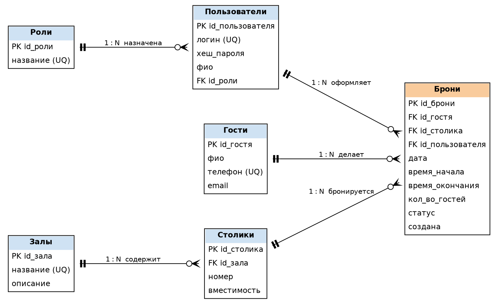

# ПП.02, неделя 1. Анализ и проектирование

Тема: «Разработка защищенной базы данных системы бронирования столиков в кафе». Студент: Войнов Д.А., 3ИП-7-24.

## Введение

Цель недели 1 — проанализировать предметную область кафе с бронированием столиков, выделить сущности, их атрибуты и связи, построить ER-диаграмму и привести модель к третьей нормальной форме. Результат станет основой защищённой базы данных системы бронирования (ПП.02).

## Описание предметной области

Кафе состоит из нескольких залов, в каждом зале расставлены пронумерованные столики разной вместимости. Гость (посетитель) обращается в кафе, чтобы забронировать столик на определённую дату и время для заданного количества человек.

Бронь оформляет пользователь системы: администратор или менеджер кафе, либо сам гость через сайт. Каждый пользователь имеет роль, от которой зависят его права: администратор управляет залами, столиками и пользователями; менеджер подтверждает, отклоняет и отменяет брони; гость может только создать бронь и просмотреть свои брони.

Бронь проходит статусы: «новая» → «подтверждена» или «отклонена»; подтверждённую бронь можно «отменить». Ограничения предметной области: число гостей не превышает вместимость столика; один столик нельзя забронировать на пересекающиеся интервалы времени; пароли пользователей не хранятся в открытом виде.

Так как база данных защищённая, уже на этапе проектирования предусмотрены роли и хранение только хеша пароля; реализация механизмов защиты выполняется на неделе 3.

## Сущности и атрибуты

### Роли

Роль пользователя системы, задаёт права доступа (администратор, менеджер, гость).

| Атрибут | Описание |
|---|---|
| id_роли | PK, целое |
| название | строка, уникальное |

### Пользователи

Учётная запись сотрудника или клиента системы бронирования.

| Атрибут | Описание |
|---|---|
| id_пользователя | PK, целое |
| логин | строка, уникальное |
| хеш_пароля | строка (пароль хранится только в виде хеша) |
| фио | строка |
| id_роли | FK → Роли |

### Гости

Посетитель кафе, на которого оформляется бронь.

| Атрибут | Описание |
|---|---|
| id_гостя | PK, целое |
| фио | строка |
| телефон | строка, уникальное |
| email | строка, необязательное |

### Залы

Помещение кафе (основной зал, веранда, VIP).

| Атрибут | Описание |
|---|---|
| id_зала | PK, целое |
| название | строка, уникальное |
| описание | текст |

### Столики

Столик в конкретном зале.

| Атрибут | Описание |
|---|---|
| id_столика | PK, целое |
| id_зала | FK → Залы |
| номер | целое, уникален в пределах зала |
| вместимость | целое > 0 |

### Брони

Бронирование столика гостем на дату и интервал времени.

| Атрибут | Описание |
|---|---|
| id_брони | PK, целое |
| id_гостя | FK → Гости |
| id_столика | FK → Столики |
| id_пользователя | FK → Пользователи (кто оформил) |
| дата | дата |
| время_начала | время |
| время_окончания | время, больше времени начала |
| кол_во_гостей | целое > 0, не больше вместимости |
| статус | новая / подтверждена / отклонена / отменена |
| создана | дата-время создания |

## Связи

| Связь | Тип | Описание |
|---|---|---|
| Роли – Пользователи | 1 : N | одна роль назначена многим пользователям, у пользователя ровно одна роль |
| Залы – Столики | 1 : N | в зале много столиков, столик стоит в одном зале |
| Гости – Брони | 1 : N | гость может сделать много броней, бронь принадлежит одному гостю |
| Столики – Брони | 1 : N | столик бронируется многократно на разное время, бронь относится к одному столику |
| Пользователи – Брони | 1 : N | пользователь оформляет много броней, у брони один оформивший |

## ER-диаграмма

Исходник: `er.dot` (Graphviz, нотация «воронья лапка»).

## Нормализация

### Исходное отношение

Изначально все данные о брони можно записать одной таблицей «Журнал броней»: (номер_брони, фио_гостя, телефоны_гостя, название_зала, описание_зала, номер_столика, вместимость, дата, время_начала, время_окончания, кол_во_гостей, статус, логин_оформившего, фио_оформившего, роль_оформившего). В ней дублируются данные гостей, залов и сотрудников, возможны аномалии вставки, удаления и обновления.

### 1НФ

Все атрибуты делаются атомарными: поле «телефоны_гостя» с несколькими номерами заменяется одним атрибутом «телефон», ФИО хранится одной строкой, дата и время разнесены по отдельным полям. Повторяющихся групп нет, у каждой строки есть ключ id_брони. Отношение находится в 1НФ.

### 2НФ

Вводятся суррогатные простые первичные ключи (id_гостя, id_зала, id_столика, id_пользователя, id_роли). Для таблиц с простым ключом частичные зависимости невозможны. Составной потенциальный ключ (id_зала, номер) у столика: вместимость зависит от всего столика, а не от зала отдельно, поэтому данные зала (название, описание) выносятся в «Залы». Отношение находится в 2НФ.

### 3НФ

Устраняются транзитивные зависимости: id_брони → телефон → фио_гостя (данные гостя вынесены в «Гости»); id_брони → id_столика → вместимость, id_зала (вынесены в «Столики»); id_брони → логин → роль (вынесены в «Пользователи» и «Роли»). В «Брони» остаются только атрибуты, зависящие от ключа id_брони, и внешние ключи. В итоге получено 6 отношений: Роли, Пользователи, Гости, Залы, Столики, Брони — все в 3НФ.

## Вывод

В ходе недели 1 проанализирована предметная область кафе с бронированием столиков, выделено 6 сущностей (Роли, Пользователи, Гости, Залы, Столики, Брони), определены их атрибуты и 5 связей типа «один ко многим». Построена ER-диаграмма, модель последовательно приведена к 1НФ, 2НФ и 3НФ. Полученная модель будет использована на неделе 2 для создания физической базы данных.
