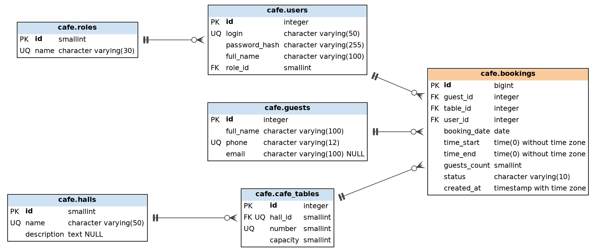
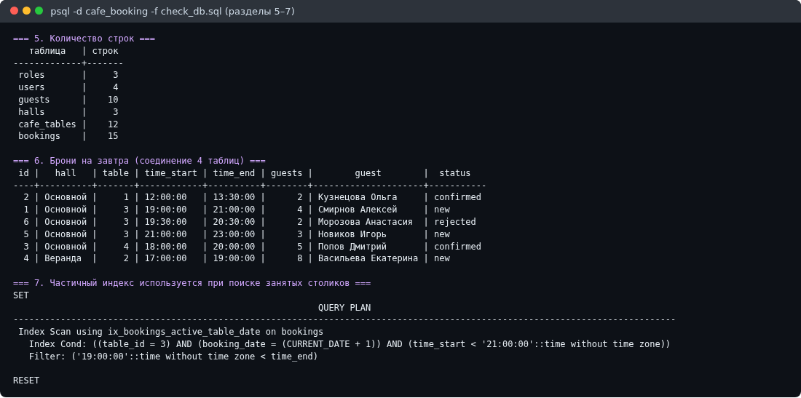
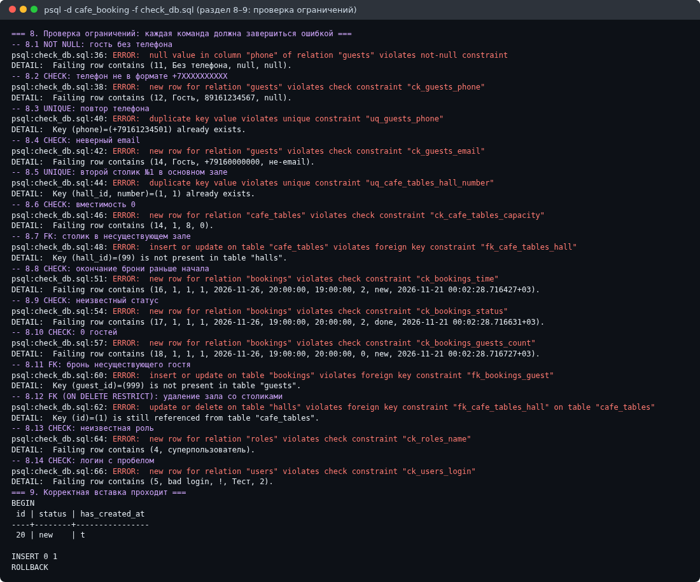

# ПП.02, неделя 2 (этап 6). Физическая модель

Тема: «Разработка защищенной базы данных системы бронирования столиков в кафе». Студент: Войнов Д.А., 3ИП-7-24.

## Введение

Цель этапа 6 — по модели этапа 5 (ER-диаграмма и нормализация до 3НФ, папка PP.02/week1) написать SQL-скрипт создания базы данных системы бронирования столиков в кафе: таблицы, первичные и внешние ключи, ограничения CHECK, UNIQUE, NOT NULL, индексы и тестовые данные. Скрипты залиты в репозиторий в папку PP.02/week2. Роли и права, хеширование паролей, журнал аудита и резервное копирование выполняются на этапе 7, триггеры и представления — на этапе 8.

## Выбор СУБД

Для базы данных выбрана PostgreSQL (скрипты проверены на версии 17.12). Тема ПП.02 — защищённая база данных, а на этапе 7 нужны роли с разграничением прав доступа (администратор, менеджер, гость). PostgreSQL поддерживает роли и привилегии на уровне таблиц и отдельных столбцов (GRANT/REVOKE), триггеры и представления, расширение pgcrypto для хеширования паролей и утилиты pg_dump/pg_restore для резервного копирования. Модуль бронирования ПП.11 работает на рабочем черновике SQLite с теми же шестью таблицами; в SQLite нет пользователей и прав доступа, поэтому для официальной защищённой базы ПП.02 он не подходит. Имена таблиц и столбцов совпадают с черновиком (поле даты брони названо booking_date, так как date — имя типа), поэтому модуль можно перевести на PostgreSQL без изменения модели.

## Состав скриптов

**Таблица 3.1 — Файлы этапа 6 (PP.02/week2)**

| Файл | Назначение |
|---|---|
| 01_schema.sql | создание схемы cafe, 6 таблиц с ключами и ограничениями, индексы |
| 02_test_data.sql | тестовые данные: роли, пользователи, залы, столики, гости, брони (даты считаются от текущей даты) |
| check_db.sql | проверка: список таблиц, ограничения, индексы, данные, план запроса, попытки нарушить ограничения |
| check_output.txt | полный вывод проверки на PostgreSQL 17 |
| er_physical.py, schema.dot, schema.png | схема таблиц, построенная по системному каталогу созданной базы |

```
createdb cafe_booking
psql -d cafe_booking -v ON_ERROR_STOP=1 -f 01_schema.sql -f 02_test_data.sql
psql -d cafe_booking -f check_db.sql
```

## Таблицы базы данных

Все объекты создаются в отдельной схеме cafe. Сущности этапа 5 переведены в таблицы один к одному. Первичные ключи — суррогатные, с автонумерацией GENERATED BY DEFAULT AS IDENTITY. Внешние ключи объявлены с ON DELETE RESTRICT: нельзя удалить зал со столиками, столик, гостя или пользователя, у которых есть брони, — история броней не теряется. Описания таблиц ниже получены из системного каталога созданной базы.

**Таблица 4.1 — roles (Роли)**

| Столбец | Атрибут этапа 5 | Тип | Ограничения |
|---|---|---|---|
| id | id_роли | smallint | PK; автонумерация (IDENTITY) |
| name | название | varchar(30) | NOT NULL; CHECK ck_roles_name: (name IN ('администратор', 'менеджер', 'гость')); UNIQUE |

**Таблица 4.2 — users (Пользователи)**

| Столбец | Атрибут этапа 5 | Тип | Ограничения |
|---|---|---|---|
| id | id_пользователя | integer | PK; автонумерация (IDENTITY) |
| login | логин | varchar(50) | NOT NULL; CHECK ck_users_login: (login ~ '^[a-z0-9_.]{3,50}$'); UNIQUE |
| password_hash | хеш_пароля | varchar(255) | NOT NULL; CHECK ck_users_password_hash: (password_hash <> '') |
| full_name | фио | varchar(100) | NOT NULL; CHECK ck_users_full_name: (btrim(full_name) <> '') |
| role_id | id_роли | smallint | NOT NULL; FK → roles(id) |

**Таблица 4.3 — guests (Гости)**

| Столбец | Атрибут этапа 5 | Тип | Ограничения |
|---|---|---|---|
| id | id_гостя | integer | PK; автонумерация (IDENTITY) |
| full_name | фио | varchar(100) | NOT NULL; CHECK ck_guests_full_name: (btrim(full_name) <> '') |
| phone | телефон | varchar(12) | NOT NULL; CHECK ck_guests_phone: (phone ~ '^\+7[0-9]{10}$'); UNIQUE |
| email | email | varchar(100) | CHECK ck_guests_email: (email IS NULL OR email ~ '^[^@[:space:]]+@[^@[:space:]]+\.[^@[:space:]]+$') |

**Таблица 4.4 — halls (Залы)**

| Столбец | Атрибут этапа 5 | Тип | Ограничения |
|---|---|---|---|
| id | id_зала | smallint | PK; автонумерация (IDENTITY) |
| name | название | varchar(50) | NOT NULL; CHECK ck_halls_name: (btrim(name) <> ''); UNIQUE |
| description | описание | text | — |

**Таблица 4.5 — cafe_tables (Столики)**

| Столбец | Атрибут этапа 5 | Тип | Ограничения |
|---|---|---|---|
| id | id_столика | integer | PK; автонумерация (IDENTITY) |
| hall_id | id_зала | smallint | NOT NULL; UNIQUE (вместе с number); FK → halls(id) |
| number | номер | smallint | NOT NULL; CHECK ck_cafe_tables_number: (number > 0); UNIQUE (вместе с hall_id) |
| capacity | вместимость | smallint | NOT NULL; CHECK ck_cafe_tables_capacity: (capacity BETWEEN 1 AND 20) |

**Таблица 4.6 — bookings (Брони)**

| Столбец | Атрибут этапа 5 | Тип | Ограничения |
|---|---|---|---|
| id | id_брони | bigint | PK; автонумерация (IDENTITY) |
| guest_id | id_гостя | integer | NOT NULL; FK → guests(id) |
| table_id | id_столика | integer | NOT NULL; FK → cafe_tables(id) |
| user_id | id_пользователя | integer | NOT NULL; FK → users(id) |
| booking_date | дата | date | NOT NULL |
| time_start | время_начала | time(0) | NOT NULL; CHECK ck_bookings_time: (time_end > time_start) |
| time_end | время_окончания | time(0) | NOT NULL; CHECK ck_bookings_time: (time_end > time_start) |
| guests_count | кол_во_гостей | smallint | NOT NULL; CHECK ck_bookings_guests_count: (guests_count BETWEEN 1 AND 50) |
| status | статус | varchar(10) | NOT NULL; CHECK ck_bookings_status: (status IN ('new', 'confirmed', 'rejected', 'cancelled')); DEFAULT 'new' |
| created_at | создана | timestamptz | NOT NULL; DEFAULT now() |

Фрагмент скрипта 01_schema.sql — таблица броней:

```
-- ---------- Брони ----------
CREATE TABLE bookings (
    id            bigint      GENERATED BY DEFAULT AS IDENTITY,
    guest_id      integer     NOT NULL,
    table_id      integer     NOT NULL,
    user_id       integer     NOT NULL,
    booking_date  date        NOT NULL,
    time_start    time(0)     NOT NULL,
    time_end      time(0)     NOT NULL,
    guests_count  smallint    NOT NULL,
    status        varchar(10) NOT NULL DEFAULT 'new',
    created_at    timestamptz NOT NULL DEFAULT now(),
    CONSTRAINT pk_bookings PRIMARY KEY (id),
    CONSTRAINT ck_bookings_time CHECK (time_end > time_start),
    CONSTRAINT ck_bookings_guests_count CHECK (guests_count BETWEEN 1 AND 50),
    CONSTRAINT ck_bookings_status CHECK (status IN ('new', 'confirmed', 'rejected', 'cancelled')),
    CONSTRAINT fk_bookings_guest FOREIGN KEY (guest_id) REFERENCES guests (id)
        ON UPDATE CASCADE ON DELETE RESTRICT,
    CONSTRAINT fk_bookings_table FOREIGN KEY (table_id) REFERENCES cafe_tables (id)
        ON UPDATE CASCADE ON DELETE RESTRICT,
    CONSTRAINT fk_bookings_user FOREIGN KEY (user_id) REFERENCES users (id)
        ON UPDATE CASCADE ON DELETE RESTRICT
);
COMMENT ON TABLE bookings IS 'Брони столиков';
COMMENT ON COLUMN bookings.status IS 'new — новая, confirmed — подтверждена, rejected — отклонена, cancelled — отменена';
```

## Ограничения целостности

**Таблица 5.1 — Ограничения предметной области**

| Правило (этап 5) | Как реализовано |
|---|---|
| у каждой строки есть ключ | PRIMARY KEY во всех 6 таблицах |
| связи 1 : N | 5 внешних ключей: users → roles, cafe_tables → halls, bookings → guests, cafe_tables, users |
| название роли, логин, телефон гостя, название зала уникальны | UNIQUE uq_roles_name, uq_users_login, uq_guests_phone, uq_halls_name |
| номер столика уникален в пределах зала | UNIQUE (hall_id, number) |
| вместимость > 0, количество гостей > 0 | CHECK capacity BETWEEN 1 AND 20, guests_count BETWEEN 1 AND 50 |
| время окончания больше времени начала | CHECK (time_end > time_start) |
| статус: новая / подтверждена / отклонена / отменена | CHECK status IN (new, confirmed, rejected, cancelled), DEFAULT new |
| формат телефона и email | CHECK по регулярным выражениям: +7 и 10 цифр; адрес вида имя@домен.зона |
| обязательные поля | NOT NULL у всех полей, кроме email гостя и описания зала |
| пароль не хранится в открытом виде | столбец password_hash; хеширование — этап 7 |
| гостей не больше вместимости, нет пересечений броней | проверяются триггерами на этапе 8 (правила затрагивают несколько таблиц и строк) |

## Индексы

**Таблица 6.1 — Индексы**

| Индекс | Назначение |
|---|---|
| pk_* (6 шт.), uq_* (5 шт.) | создаются автоматически для первичных ключей и ограничений UNIQUE |
| ix_users_role | поиск пользователей роли, проверка FK при удалении роли |
| ix_bookings_guest, ix_bookings_user | брони гостя и брони, оформленные сотрудником; проверка FK |
| ix_bookings_active_table_date (частичный, WHERE status IN (new, confirmed)) | поиск занятых столиков на дату и проверка пересечений: в индекс попадают только активные брони |
| ix_bookings_date_status | расписание броней на дату для администратора и менеджера |

```
-- ---------- Индексы ----------
-- Внешние ключи (PostgreSQL не создаёт индексы для них автоматически)
CREATE INDEX ix_users_role ON users (role_id);
CREATE INDEX ix_bookings_guest ON bookings (guest_id);
CREATE INDEX ix_bookings_user ON bookings (user_id);
-- Поиск занятых столиков на дату: только активные брони (частичный индекс)
CREATE INDEX ix_bookings_active_table_date ON bookings (table_id, booking_date, time_start)
    WHERE status IN ('new', 'confirmed');
-- Расписание на дату для администратора и менеджера
CREATE INDEX ix_bookings_date_status ON bookings (booking_date, status);
-- cafe_tables(hall_id, number), users(login), guests(phone), halls(name), roles(name)
-- уже проиндексированы ограничениями UNIQUE.
```

## Тестовые данные

Скрипт 02_test_data.sql заполняет базу: 3 роли, 4 пользователя (служебная запись сайта, администратор, два менеджера), 3 зала, 12 столиков, 10 гостей и 15 броней во всех статусах (new — 6, confirmed — 6, rejected — 1, cancelled — 2). Даты броней задаются от текущей даты (current_date + N), поэтому данные не устаревают. Активные брони одного столика по времени не пересекаются, количество гостей не превышает вместимость. Пароли пользователей на этом этапе не заданы (значение «!» — вход запрещён), они будут храниться в виде хеша после этапа 7.

## Схема таблиц

Схема построена скриптом er_physical.py по системному каталогу PostgreSQL созданной базы, поэтому она точно соответствует скрипту: столбцы, типы, отметки PK, FK, UQ и связи по внешним ключам.



*Рисунок 1 — Схема таблиц базы данных cafe_booking (физическая модель)*

## Проверка скрипта

Скрипты выполнены на PostgreSQL 17.12 в новой базе cafe_booking без ошибок (psql с ON_ERROR_STOP). Затем check_db.sql вывел структуру, количество строк, брони на завтра (соединение 4 таблиц) и план запроса поиска занятых столиков: используется частичный индекс ix_bookings_active_table_date.



*Рисунок 2 — Заполненная база: количество строк, брони на завтра, план запроса*

Проверка ограничений: 14 некорректных команд, каждая отклонена СУБД с указанием нарушенного ограничения, корректная вставка проходит.

**Таблица 9.1 — Проверка ограничений**

| Попытка | Результат |
|---|---|
| гость без телефона | NOT NULL: отказ |
| телефон 89161234567 | CHECK ck_guests_phone: отказ |
| повтор телефона | UNIQUE uq_guests_phone: отказ |
| email «не-email» | CHECK ck_guests_email: отказ |
| второй столик №1 в зале | UNIQUE uq_cafe_tables_hall_number: отказ |
| вместимость 0 | CHECK ck_cafe_tables_capacity: отказ |
| столик в зале 99 | FK fk_cafe_tables_hall: отказ |
| окончание брони раньше начала | CHECK ck_bookings_time: отказ |
| статус done | CHECK ck_bookings_status: отказ |
| 0 гостей | CHECK ck_bookings_guests_count: отказ |
| бронь гостя 999 | FK fk_bookings_guest: отказ |
| удаление зала со столиками | FK ON DELETE RESTRICT: отказ |
| роль «суперпользователь» | CHECK ck_roles_name: отказ |
| логин с пробелом | CHECK ck_users_login: отказ |
| корректная бронь | вставлена, статус new и время создания заданы по умолчанию |



*Рисунок 3 — Проверка ограничений целостности*

## Вывод

На этапе 6 по модели этапа 5 создана физическая база данных на PostgreSQL: 6 таблиц в схеме cafe с первичными и внешними ключами, 13 ограничениями CHECK, ограничениями UNIQUE и NOT NULL, 5 дополнительными индексами, включая частичный индекс активных броней. База заполнена тестовыми данными, скрипт выполняется без ошибок, все ограничения проверены попытками их нарушить. Схема таблиц построена по каталогу созданной базы. На этапе 7 к базе будут добавлены роли и права доступа, хеширование паролей, журнал аудита и резервное копирование.
