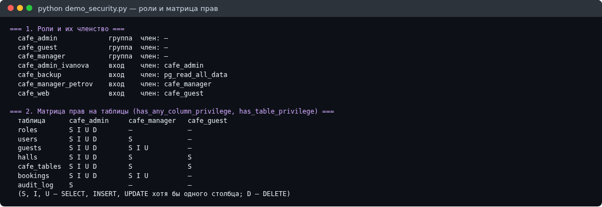
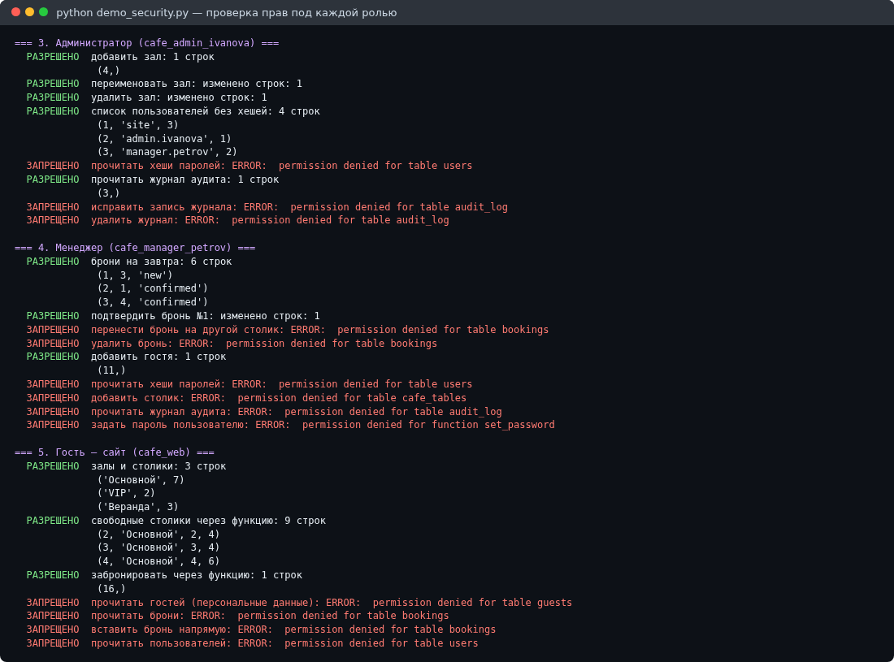
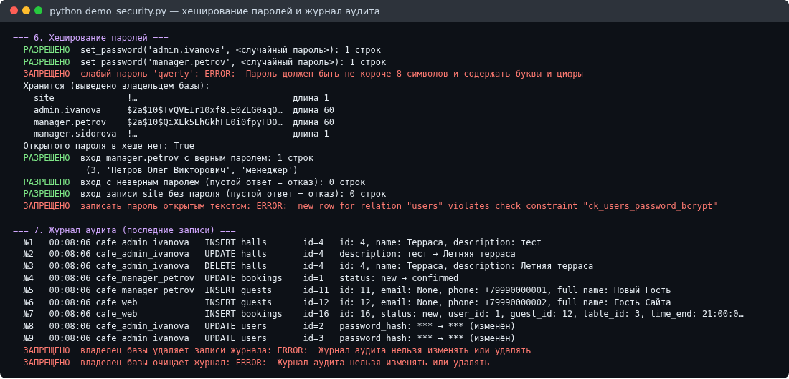
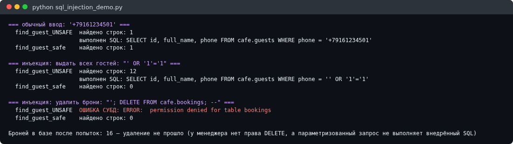
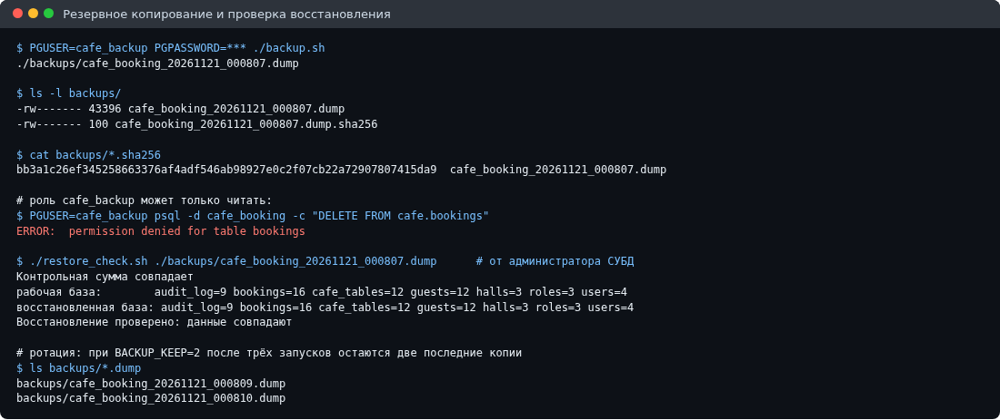

# ПП.02, неделя 3 (этап 7). Защита данных

Тема: «Разработка защищенной базы данных системы бронирования столиков в кафе». Студент: Войнов Д.А., 3ИП-7-24.

## Введение

Цель этапа 7 — реализовать защиту базы данных системы бронирования столиков, созданной на этапе 6 (PostgreSQL, схема cafe): роли и права доступа для администратора, менеджера и гостя, хеширование паролей, параметризованные запросы против SQL-инъекций, журнал аудита изменений и резервное копирование, и показать работу каждого механизма. Материалы залиты в репозиторий в папку PP.02/week3 (неделя 3 = этап 7).

**Таблица 1.1 — Файлы этапа 7 (PP.02/week3)**

| Файл | Назначение |
|---|---|
| 03_security.sql | роли и права, хеширование паролей, функции для сайта, журнал аудита |
| backup.sh, restore_check.sh | резервное копирование с ротацией и проверка восстановления |
| demo_security.py → demo_output.txt | проверка прав под каждой ролью, паролей и журнала аудита |
| sql_injection_demo.py → injection_output.txt | сравнение склейки строки и параметризованного запроса |
| backup_output.txt | вывод резервного копирования и проверки восстановления |
| run_demo.sh | пересоздание базы и запуск всех демонстраций |

Пароли ролей входа в СУБД не хранятся в скриптах и репозитории: 03_security.sql читает их из переменных окружения (CAFE_ADMIN_DB_PASSWORD и др.) командой psql \getenv и останавливается, если они не заданы. При демонстрации пароли генерировались случайно на время запуска.

## Роли и права доступа

Права выдаются по принципу минимальных привилегий. Сначала у PUBLIC отбираются все права на базу, схему cafe, таблицы и функции, затем каждой роли выдаётся только необходимое. Используются групповые роли без входа и учётные записи, входящие в группу: при появлении нового сотрудника достаточно создать вход и включить его в группу.

**Таблица 2.1 — Роли**

| Роль | Тип | Назначение |
|---|---|---|
| cafe_admin | группа | администратор: справочники (залы, столики, роли), пользователи, все брони |
| cafe_manager | группа | менеджер: гости и брони, подтверждение и отклонение, без удаления |
| cafe_guest | группа | гость — сайт бронирования: залы и столики, бронь только через функции |
| cafe_admin_ivanova | вход | администратор Иванова А.С. (член cafe_admin) |
| cafe_manager_petrov | вход | менеджер Петров О.В. (член cafe_manager) |
| cafe_web | вход | бэкенд сайта (член cafe_guest), не более 20 подключений |
| cafe_backup | вход | резервное копирование: только чтение (встроенная роль pg_read_all_data) |

```
-- Групповые роли (без входа) — соответствуют ролям предметной области
CREATE ROLE cafe_admin   NOLOGIN;   -- администратор: справочники, пользователи, все брони
CREATE ROLE cafe_manager NOLOGIN;   -- менеджер: гости и брони, смена статуса
CREATE ROLE cafe_guest   NOLOGIN;   -- гость (сайт): только просмотр залов и бронирование через функции
-- Учётные записи входа; пароли хранятся в PostgreSQL как SCRAM-SHA-256
SET password_encryption = 'scram-sha-256';
CREATE ROLE cafe_admin_ivanova  LOGIN PASSWORD :'admin_pw'   IN ROLE cafe_admin;
CREATE ROLE cafe_manager_petrov LOGIN PASSWORD :'manager_pw' IN ROLE cafe_manager;
CREATE ROLE cafe_web            LOGIN PASSWORD :'web_pw'     IN ROLE cafe_guest CONNECTION LIMIT 20;
-- Резервное копирование: только чтение всех данных (встроенная роль pg_read_all_data)
CREATE ROLE cafe_backup         LOGIN PASSWORD :'backup_pw'  IN ROLE pg_read_all_data;
```

**Таблица 2.2 — Права ролей**

| Объект | cafe_admin | cafe_manager | cafe_guest |
|---|---|---|---|
| roles, halls, cafe_tables | чтение, изменение, удаление | чтение halls и cafe_tables | чтение halls и cafe_tables |
| users | id, логин, ФИО, роль; без хеша пароля; удаление | id, логин, ФИО, роль (только чтение) | нет |
| guests | полный доступ | чтение, добавление, изменение ФИО и email | нет (персональные данные) |
| bookings | полный доступ | чтение, добавление, изменение только статуса | нет |
| audit_log | только чтение | нет | нет |
| set_password | да | нет | нет |
| check_password, free_tables, create_booking | да | да | да |

```
-- Администратор: справочники и брони полностью; пользователи — без доступа к хешу пароля
GRANT SELECT, INSERT, UPDATE, DELETE ON roles, halls, cafe_tables, guests, bookings TO cafe_admin;
GRANT SELECT (id, login, full_name, role_id), INSERT (login, full_name, role_id),
      UPDATE (login, full_name, role_id), DELETE ON users TO cafe_admin;
GRANT USAGE, SELECT ON ALL SEQUENCES IN SCHEMA cafe TO cafe_admin;

-- Менеджер: просмотр залов и столиков, работа с гостями и бронями без удаления
GRANT SELECT ON halls, cafe_tables, guests, bookings TO cafe_manager;
GRANT SELECT (id, login, full_name, role_id) ON users TO cafe_manager;
GRANT INSERT ON guests, bookings TO cafe_manager;
GRANT UPDATE (full_name, email) ON guests TO cafe_manager;
GRANT UPDATE (status) ON bookings TO cafe_manager;
GRANT USAGE ON SEQUENCE guests_id_seq, bookings_id_seq TO cafe_manager;

-- Гость (сайт): только залы и столики; персональные данные гостей и брони недоступны
GRANT SELECT ON halls, cafe_tables TO cafe_guest;
```

Демонстрация: скрипт demo_security.py подключается под каждой учётной записью и пробует разрешённые и запрещённые действия. Запрещённые действия отклоняет сама СУБД с ошибкой permission denied, поэтому защиту нельзя обойти ошибкой в приложении.



*Рисунок 1 — Роли и матрица прав (по системному каталогу)*



*Рисунок 2 — Проверка прав администратора, менеджера и сайта*

Итог проверки: администратор управляет залами, но не видит хеши паролей и не может изменить журнал аудита; менеджер подтверждает бронь, но не может перенести её на другой столик, удалить, добавить столик или прочитать журнал; сайт видит только залы и столики, бронирует через функцию create_booking, а прочитать гостей, брони и пользователей не может.

## Хеширование паролей

Пароли пользователей системы (таблица users) хранятся только в виде bcrypt-хеша (расширение pgcrypto, функция crypt с солью gen_salt('bf', 10) — 2^10 раундов). Соль своя у каждого пароля и хранится внутри хеша, поэтому одинаковые пароли дают разные хеши. Ограничение ck_users_password_bcrypt не даёт записать в столбец ничего, кроме bcrypt-хеша или «!» (вход запрещён), — открытый пароль сохранить нельзя даже владельцу базы. Пароль задаёт только администратор функцией set_password, которая проверяет сложность (не короче 8 символов, буквы и цифры). Вход проверяет функция check_password: при неверном пароле она возвращает пустой результат, а для несуществующего логина всё равно вычисляет хеш, чтобы по времени ответа нельзя было узнать, существует ли логин. Пароли ролей входа в саму СУБД PostgreSQL хранит в виде SCRAM-SHA-256.

```
CREATE FUNCTION set_password(p_login text, p_password text) RETURNS void
LANGUAGE plpgsql SECURITY DEFINER SET search_path = pg_catalog, pg_temp AS $$
BEGIN
    IF NOT pg_has_role(session_user, 'cafe_admin', 'MEMBER') THEN
        RAISE EXCEPTION 'Задавать пароли может только администратор' USING ERRCODE = 'insufficient_privilege';
    END IF;
    IF length(p_password) < 8 OR p_password !~ '[0-9]' OR p_password !~ '[A-Za-zА-Яа-яЁё]' THEN
        RAISE EXCEPTION 'Пароль должен быть не короче 8 символов и содержать буквы и цифры'
            USING ERRCODE = 'check_violation';
    END IF;
    UPDATE cafe.users SET password_hash = public.crypt(p_password, public.gen_salt('bf', 10))
    WHERE login = p_login;
    IF NOT FOUND THEN
        RAISE EXCEPTION 'Пользователь % не найден', p_login USING ERRCODE = 'no_data_found';
    END IF;
END $$;
```



*Рисунок 3 — Хеширование паролей и журнал аудита*

## Защита от SQL-инъекций

SQL-инъекция возможна, когда введённое значение вставляется прямо в текст запроса. Во всех запросах проекта значения передаются отдельно от текста как параметры: в модуле ПП.11 — через «?» в sqlite3, в функциях базы — через параметры PL/pgSQL (статический SQL, без EXECUTE со склейкой строк), в Python-скриптах — через %s в psycopg2. Скрипт sql_injection_demo.py сравнивает два способа под ролью менеджера.

```
def find_guest_UNSAFE(phone):
    """ОПАСНО: значение вставляется прямо в текст SQL."""
    sql = "SELECT id, full_name, phone FROM cafe.guests WHERE phone = '" + phone + "'"
    cur = conn.cursor()
    cur.execute(sql)
    return sql, cur.fetchall() if cur.description else []


def find_guest_safe(phone):
    """Безопасно: значение передаётся отдельно от текста запроса (параметр %s)."""
    sql = "SELECT id, full_name, phone FROM cafe.guests WHERE phone = %s"
    cur = conn.cursor()
    cur.execute(sql, (phone,))
    return sql, cur.fetchall()
```

**Таблица 4.1 — Результат**

| Ввод | Склейка строки | Параметр |
|---|---|---|
| +79161234501 | 1 строка | 1 строка |
| ' OR '1'='1 | 12 строк — утечка всех гостей | 0 строк |
| '; DELETE FROM cafe.bookings; -- | выполнен внедрённый DELETE, остановлен только правами (permission denied) | 0 строк, DELETE не выполнялся |



*Рисунок 4 — Склейка строки и параметризованный запрос*

Пример показывает и пользу разграничения прав: даже при уязвимом коде менеджер не может удалить брони, потому что у его роли нет права DELETE.

## Журнал аудита изменений

Таблица audit_log хранит каждое изменение шести таблиц: время, учётную запись СУБД (session_user), операцию, таблицу, id строки и данные до и после изменения в формате jsonb. Записи добавляет триггерная функция audit_trigger (AFTER INSERT/UPDATE/DELETE, для каждой строки). Хеш пароля в журнал не попадает — вместо него «***», а при смене пароля «*** (изменён)». Журнал доступен для чтения только администратору; изменить или очистить его не может никто, включая владельца базы: это запрещают триггеры BEFORE UPDATE/DELETE и BEFORE TRUNCATE.

```
CREATE FUNCTION audit_trigger() RETURNS trigger
LANGUAGE plpgsql SECURITY DEFINER SET search_path = pg_catalog, pg_temp AS $$
DECLARE
    o jsonb := CASE WHEN TG_OP <> 'INSERT' THEN to_jsonb(OLD) END;
    n jsonb := CASE WHEN TG_OP <> 'DELETE' THEN to_jsonb(NEW) END;
BEGIN
    IF TG_OP = 'UPDATE' AND o = n THEN
        RETURN NULL;                                   -- ничего не изменилось
    END IF;
    IF TG_TABLE_NAME = 'users' THEN                    -- хеш пароля в журнал не пишется
        IF o ? 'password_hash' THEN o := o || '{"password_hash": "***"}'; END IF;
        IF n ? 'password_hash' THEN
            n := n || jsonb_build_object('password_hash',
                 CASE WHEN TG_OP = 'UPDATE' AND OLD.password_hash IS DISTINCT FROM NEW.password_hash
                      THEN '*** (изменён)' ELSE '***' END);
        END IF;
    END IF;
    INSERT INTO cafe.audit_log (operation, table_name, row_id, old_data, new_data)
    VALUES (TG_OP, TG_TABLE_NAME, (coalesce(n, o) ->> 'id')::bigint, o, n);
    RETURN NULL;
END $$;

DO $$
DECLARE t text;
BEGIN
    FOREACH t IN ARRAY ARRAY['roles', 'users', 'guests', 'halls', 'cafe_tables', 'bookings'] LOOP
        EXECUTE format('CREATE TRIGGER trg_%s_audit AFTER INSERT OR UPDATE OR DELETE ON cafe.%I '
                       'FOR EACH ROW EXECUTE FUNCTION cafe.audit_trigger()', t, t);
    END LOOP;
END $$;
```

В демонстрации журнал записал добавление, изменение и удаление зала администратором, подтверждение брони менеджером (только изменённое поле status: new → confirmed), бронирование через сайт и смену паролей. Попытки владельца базы удалить запись и очистить журнал отклонены.

## Резервное копирование

Скрипт backup.sh делает копию базы утилитой pg_dump в сжатом формате custom от роли cafe_backup, у которой есть только право чтения. Копии создаются с правами 600 (umask 077), для каждой сохраняется контрольная сумма SHA-256, сразу проверяется, что архив читается (pg_restore --list), и хранятся только последние BACKUP_KEEP копий (по умолчанию 7). Скрипт рассчитан на запуск по расписанию, например ежедневно через cron. Скрипт restore_check.sh проверяет копию: сверяет контрольную сумму, восстанавливает её в отдельную базу и сравнивает количество строк во всех таблицах с рабочей базой.

```
#!/usr/bin/env bash
# ПП.02, этап 7. Резервное копирование базы cafe_booking.
# Выполняется от роли cafe_backup (только чтение: pg_read_all_data).
# Пароль — в переменной PGPASSWORD или в файле ~/.pgpass (права 600), не в скрипте.
#   PGUSER=cafe_backup ./backup.sh            # по расписанию: cron, ежедневно в 03:00
set -euo pipefail
DB="${CAFE_DB:-cafe_booking}"
DIR="${BACKUP_DIR:-$(dirname "$0")/backups}"
KEEP="${BACKUP_KEEP:-7}"                       # сколько последних копий хранить
umask 077                                      # копии доступны только владельцу
mkdir -p "$DIR"
FILE="$DIR/${DB}_$(date +%Y%m%d_%H%M%S).dump"
pg_dump --format=custom --compress=9 --dbname="$DB" --file="$FILE"
(cd "$DIR" && sha256sum "$(basename "$FILE")" > "$(basename "$FILE").sha256")
pg_restore --list "$FILE" > /dev/null          # архив читается
ls -1t "$DIR"/"${DB}"_*.dump | tail -n +$((KEEP + 1)) | while read -r old; do
    rm -f -- "$old" "$old.sha256"              # ротация: старые копии удаляются
done
echo "$FILE"
```



*Рисунок 5 — Резервное копирование, проверка восстановления и ротация копий*

Копии хранятся в папке backups/, исключённой из репозитория. Роли и их пароли — общие объекты кластера и в pg_dump не входят: на новом сервере роли создаются скриптом 03_security.sql, после чего копия восстанавливается командой pg_restore.

## Вывод

На этапе 7 база данных защищена: введены роли администратора, менеджера и гостя с минимальными правами, включая права на отдельные столбцы; пароли пользователей хранятся только как bcrypt-хеши; все запросы параметризованные, что показано на примере SQL-инъекции; все изменения записываются в неизменяемый журнал аудита; настроено резервное копирование с проверкой восстановления. Работа каждого механизма продемонстрирована под соответствующими ролями. На этапе 8 будут добавлены триггеры и представления (запрет двойной брони и проверка вместимости) и тесты прав и ограничений.
