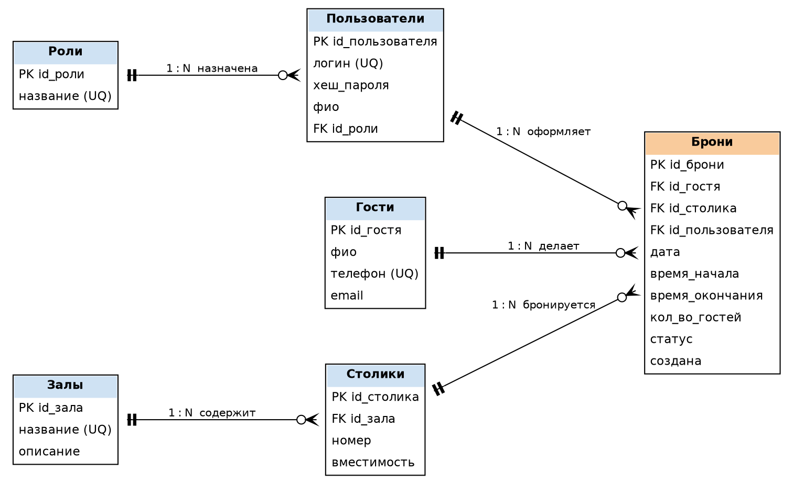
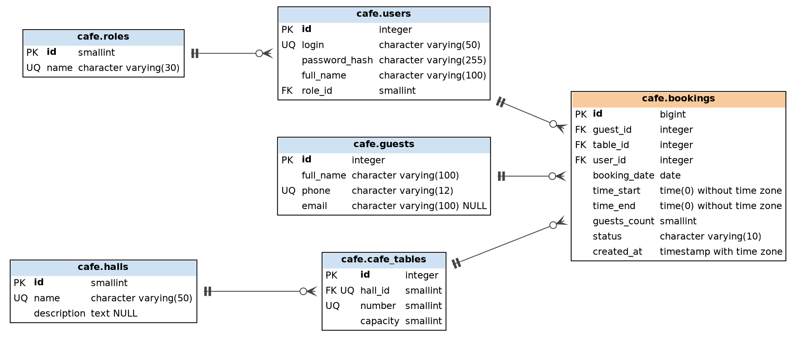
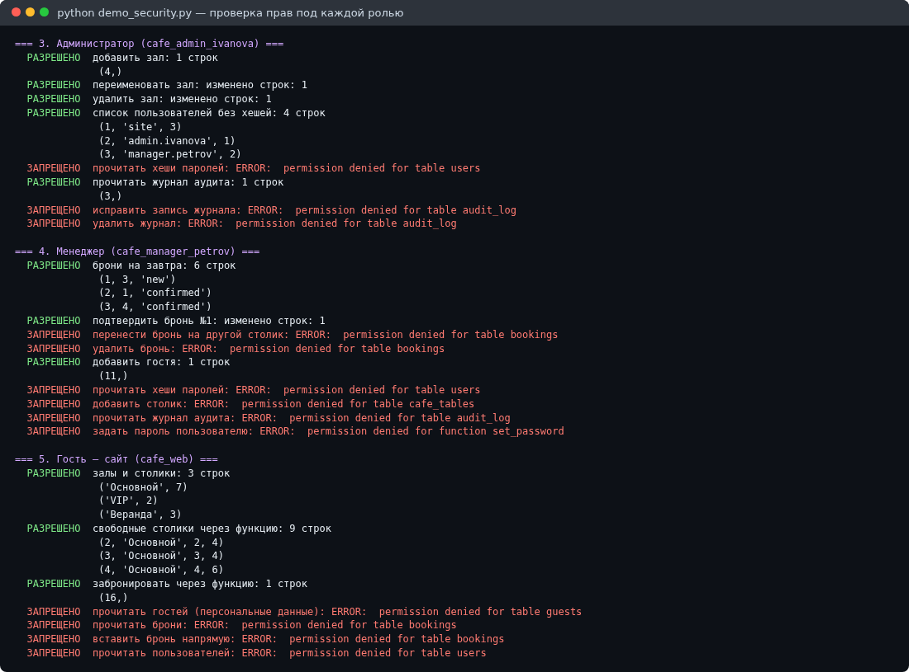
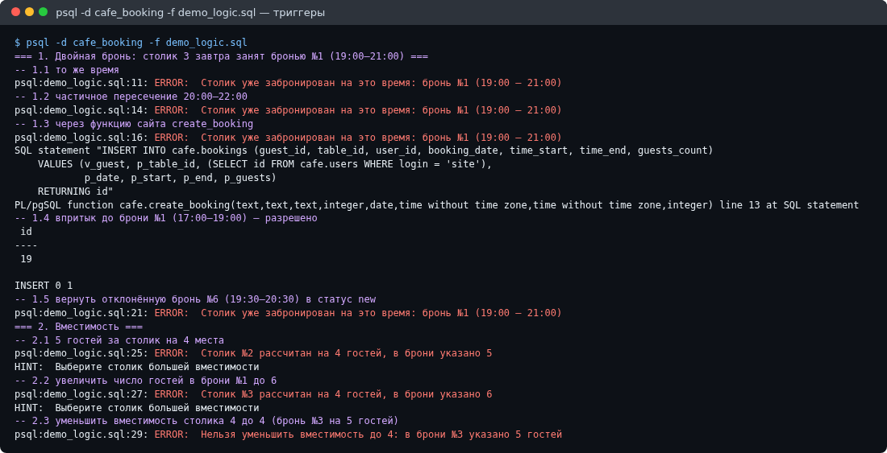
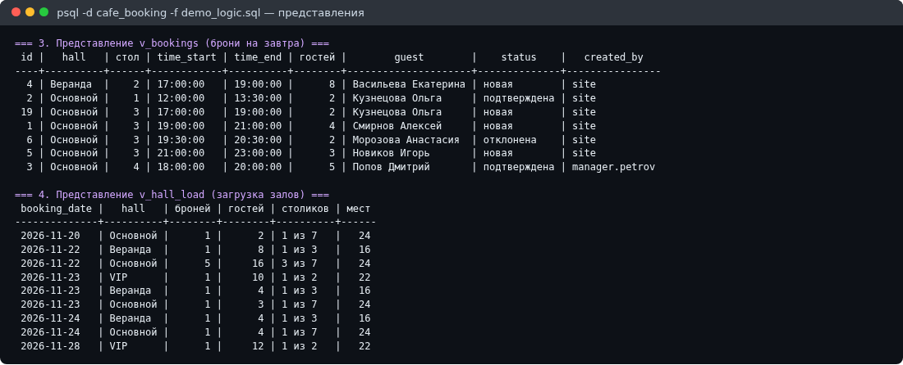
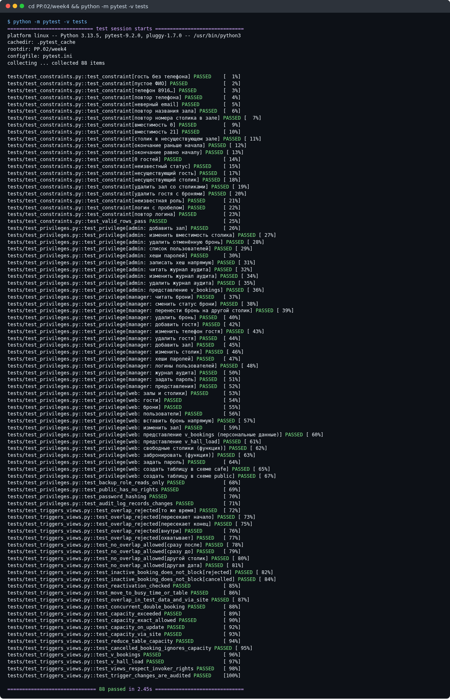

# Итоговый отчёт по ПП.02

Тема: «Разработка защищенной базы данных системы бронирования столиков в кафе». Студент: Войнов Д.А., 3ИП-7-24.

## Введение

Тема производственной практики ПП.02: «Разработка защищенной базы данных системы бронирования столиков в кафе». Цель практики — спроектировать и реализовать базу данных, в которой хранятся залы и столики кафе, гости, пользователи системы и брони, и защитить её от несанкционированного доступа и некорректных данных.

Задачи практики: проанализировать предметную область и построить ER-модель (этап 5); создать физическую модель в СУБД с ограничениями и тестовыми данными (этап 6); реализовать роли и права, хеширование паролей, защиту от SQL-инъекций, аудит и резервное копирование (этап 7); добавить триггеры и представления и протестировать права и ограничения (этап 8). В качестве СУБД выбрана PostgreSQL 17: в ней есть роли и разграничение прав GRANT/REVOKE, триггеры на PL/pgSQL, представления с проверкой прав вызывающего, расширение pgcrypto для хеширования и утилита pg_dump для резервных копий.

**Таблица 1.1 — Этапы ПП.02 и папки репозитория**

| Этап | Папка | Результат |
|---|---|---|
| 5. Анализ и проектирование | PP.02/week1 | описание предметной области, сущности, ER-диаграмма, нормализация до 3НФ |
| 6. Физическая модель | PP.02/week2 | 01_schema.sql (6 таблиц, ограничения, индексы), 02_test_data.sql, проверка скрипта |
| 7. Защита данных | PP.02/week3 | 03_security.sql (роли, права, хеши паролей, аудит), защита от SQL-инъекций, резервное копирование |
| 8. Логика и тестирование | PP.02/week4 | 04_logic.sql (триггеры и представления), 88 автотестов прав и ограничений, итоговый отчёт |

## Модель данных

База данных состоит из шести таблиц схемы cafe: roles (роли пользователей), users (пользователи системы, хранится только хеш пароля), guests (гости кафе), halls (залы), cafe_tables (столики зала с вместимостью) и bookings (брони: гость, столик, дата, время начала и окончания, число гостей, статус new/confirmed/rejected/cancelled, кто оформил). Модель приведена к третьей нормальной форме на этапе 5.



*Рисунок 1 — ER-диаграмма предметной области (этап 5)*

На этапе 6 модель реализована скриптом 01_schema.sql: первичные и внешние ключи (ON DELETE RESTRICT, чтобы нельзя было удалить зал со столиками или гостя с бронями), уникальность логина, телефона гостя, названия зала и номера столика в зале, 13 проверок CHECK (формат телефона и email, вместимость 1–20, число гостей больше нуля, окончание брони позже начала, допустимые статусы) и индексы для поиска броней по столику и дате. Скрипт 02_test_data.sql заполняет базу тестовыми данными: 3 роли, 4 пользователя, 3 зала, 12 столиков, 10 гостей и 15 броней с датами относительно текущего дня.



*Рисунок 2 — Физическая схема таблиц (этап 6)*

## Защита данных

На этапе 7 скриптом 03_security.sql реализованы механизмы защиты. Права выдаются по принципу минимальных привилегий: сначала у всех ролей отзывается всё, затем выдаётся только необходимое.

**Таблица 3.1 — Роли СУБД**

| Роль | Права |
|---|---|
| cafe_admin (вход cafe_admin_ivanova) | залы, столики, пользователи, все брони; чтение журнала аудита; смена паролей через функцию |
| cafe_manager (вход cafe_manager_petrov) | чтение залов и столиков, гости и брони, смена статуса брони; без удаления и без доступа к пользователям |
| cafe_guest (вход cafe_web — сайт) | только просмотр залов и столиков и функции free_tables и create_booking; прямого доступа к таблицам гостей и броней нет |
| cafe_backup | только чтение всех данных для pg_dump |

- пароли пользователей хранятся только в виде bcrypt-хеша (pgcrypto), проверка CHECK запрещает записать пароль открытым текстом; пароли ролей СУБД задаются через переменные окружения и в репозиторий не попадают;
- запросы из приложения выполняются только с параметрами — демонстрация показала, что склейка строки пропускает инъекцию, а параметризованный запрос нет;
- триггер аудита записывает в журнал audit_log каждое изменение залов, столиков, пользователей, гостей и броней (кто, когда, старые и новые значения; хеши паролей скрываются), журнал нельзя изменить или удалить;
- резервное копирование backup.sh делает дамп pg_dump под ролью cafe_backup с ротацией, а restore_check.sh восстанавливает его в отдельную базу и сверяет число строк.



*Рисунок 3 — Проверка прав администратора, менеджера и сайта (этап 7)*

## Триггеры

На этапе 8 скрипт 04_logic.sql добавляет в базу правила, которые нельзя выразить простыми ограничениями CHECK, потому что они зависят от других строк. Активными считаются брони в статусах new и confirmed — только они занимают столик; отклонённые и отменённые брони не мешают новым.

**Таблица 4.1 — Триггеры базы данных**

| Триггер | Таблица и событие | Что проверяет |
|---|---|---|
| trg_bookings_1_capacity | bookings, BEFORE INSERT / UPDATE столика, числа гостей, статуса | число гостей активной брони не больше вместимости столика |
| trg_bookings_2_no_overlap | bookings, BEFORE INSERT / UPDATE столика, даты, времени, статуса | у активных броней одного столика в одну дату интервалы времени не пересекаются |
| trg_cafe_tables_capacity | cafe_tables, BEFORE UPDATE вместимости (при уменьшении) | вместимость нельзя уменьшить ниже числа гостей предстоящей активной брони |

Запрет двойной брони. Интервалы считаются полуоткрытыми [начало; окончание), поэтому бронь, которая начинается ровно в момент окончания другой, разрешена. Перед поиском пересечений функция блокирует строку столика (FOR NO KEY UPDATE): если два пользователя одновременно бронируют один столик на одно время, вторая транзакция ждёт завершения первой и затем получает ошибку, а не создаёт вторую бронь.

```
-- 2. Запрет двойной брони: у активных броней одного столика в одну дату интервалы
--    [начало; окончание) не пересекаются. Строка столика блокируется (FOR NO KEY UPDATE),
--    поэтому две одновременные транзакции не смогут занять столик на одно время.
CREATE FUNCTION check_booking_overlap() RETURNS trigger
LANGUAGE plpgsql SECURITY DEFINER SET search_path = pg_catalog, pg_temp AS $$
DECLARE
    v_other record;
BEGIN
    IF NEW.status NOT IN ('new', 'confirmed') THEN
        RETURN NEW;
    END IF;
    PERFORM 1 FROM cafe.cafe_tables WHERE id = NEW.table_id FOR NO KEY UPDATE;
    SELECT b.id, b.time_start, b.time_end INTO v_other
    FROM cafe.bookings b
    WHERE b.table_id = NEW.table_id AND b.booking_date = NEW.booking_date
      AND b.status IN ('new', 'confirmed') AND b.id <> NEW.id
      AND b.time_start < NEW.time_end AND NEW.time_start < b.time_end
    LIMIT 1;
    IF FOUND THEN
        RAISE EXCEPTION 'Столик уже забронирован на это время: бронь №% (% – %)',
                        v_other.id, to_char(v_other.time_start, 'HH24:MI'), to_char(v_other.time_end, 'HH24:MI')
            USING ERRCODE = 'exclusion_violation';
    END IF;
    RETURN NEW;
END $$;
```

```
-- Триггеры одного события срабатывают по алфавиту: сначала вместимость, затем пересечение
CREATE TRIGGER trg_bookings_1_capacity
    BEFORE INSERT OR UPDATE OF table_id, guests_count, status ON bookings
    FOR EACH ROW EXECUTE FUNCTION check_booking_capacity();
CREATE TRIGGER trg_bookings_2_no_overlap
    BEFORE INSERT OR UPDATE OF table_id, booking_date, time_start, time_end, status ON bookings
    FOR EACH ROW EXECUTE FUNCTION check_booking_overlap();
```

Проверка вместимости выполняется первой (триггеры одного события срабатывают в алфавитном порядке имён), сообщение подсказывает выбрать столик побольше:

```
-- 1. Проверка вместимости: гостей не больше, чем мест за столиком
CREATE FUNCTION check_booking_capacity() RETURNS trigger
LANGUAGE plpgsql SECURITY DEFINER SET search_path = pg_catalog, pg_temp AS $$
DECLARE
    v_capacity smallint;
    v_number smallint;
BEGIN
    IF NEW.status NOT IN ('new', 'confirmed') THEN
        RETURN NEW;                                   -- отменённая/отклонённая бронь места не занимает
    END IF;
    SELECT capacity, number INTO v_capacity, v_number FROM cafe.cafe_tables WHERE id = NEW.table_id;
    IF FOUND AND NEW.guests_count > v_capacity THEN
        RAISE EXCEPTION 'Столик №% рассчитан на % гостей, в брони указано %',
                        v_number, v_capacity, NEW.guests_count
            USING ERRCODE = 'check_violation', HINT = 'Выберите столик большей вместимости';
    END IF;
    RETURN NEW;
END $$;
```

Функции триггеров объявлены SECURITY DEFINER с фиксированным search_path: проверка видит все брони столика, даже если у пользователя (например, у сайта cafe_web) нет права читать таблицу броней, а подменить объекты через search_path нельзя. Право вызывать эти функции напрямую отозвано у всех.



*Рисунок 4 — Срабатывание триггеров (demo_logic.sql)*

## Представления

**Таблица 5.1 — Представления**

| Представление | Назначение | Доступ |
|---|---|---|
| v_bookings | брони с ФИО и телефоном гостя, залом, номером и вместимостью столика, статусом по-русски и логином оформившего | cafe_admin, cafe_manager |
| v_hall_load | загрузка залов по датам: число активных броней, гостей, занятых столиков из общего числа, мест в зале | cafe_admin, cafe_manager |

Оба представления созданы с параметром security_invoker = true: права на таблицы проверяются у того, кто читает представление. Поэтому через представление нельзя получить данные, недоступные роли напрямую: сайту cafe_web права на представления не выданы, а персональные данные гостей из v_bookings ему недоступны.

```
-- Загрузка залов по датам: активные брони, гости, занятые столики, места зала
CREATE VIEW v_hall_load WITH (security_invoker = true) AS
SELECT b.booking_date,
       h.name                                   AS hall,
       count(*)                                 AS active_bookings,
       sum(b.guests_count)                      AS guests,
       count(DISTINCT b.table_id)               AS tables_booked,
       (SELECT count(*) FROM cafe_tables t2 WHERE t2.hall_id = h.id)          AS tables_total,
       (SELECT sum(t2.capacity) FROM cafe_tables t2 WHERE t2.hall_id = h.id) AS seats_total
FROM bookings b
JOIN cafe_tables t ON t.id = b.table_id
JOIN halls h       ON h.id = t.hall_id
WHERE b.status IN ('new', 'confirmed')
GROUP BY b.booking_date, h.id, h.name;
COMMENT ON VIEW v_hall_load IS 'Загрузка залов по датам (только активные брони)';
```



*Рисунок 5 — Результат запросов к представлениям*

## Тестирование прав и ограничений

Автотесты написаны на pytest с драйвером psycopg2 (папка PP.02/week4/tests). Перед запуском создаётся отдельная тестовая база cafe_booking_test, в которой по порядку выполняются все четыре скрипта; каждый тест подключается под настоящими ролями (владелец, администратор, менеджер, сайт), а после теста изменения откатываются, поэтому тесты не зависят друг от друга.

**Таблица 6.1 — Состав автотестов**

| Файл | Тестов | Что проверяется |
|---|---|---|
| test_constraints.py | 22 | 21 нарушение ограничений (пустые и неверные значения, повторы уникальных полей, ссылки на несуществующие записи, удаление связанных строк) отклоняется СУБД; корректные строки принимаются |
| test_privileges.py | 41 | 37 действий трёх ролей по матрице прав «разрешено / запрещено»; роль резервного копирования только читает; у PUBLIC нет прав; хеширование паролей; запись в журнал аудита |
| test_triggers_views.py | 25 | двойная бронь (4 варианта пересечения запрещены, 4 соседних интервала разрешены), неактивные брони, восстановление и перенос брони, бронь через сайт, одновременное бронирование двумя транзакциями, вместимость при добавлении и изменении, уменьшение вместимости столика, представления и их права, аудит изменений |

Результат: все 88 тестов пройдены (полный вывод — tests_output.txt). Тест одновременного бронирования запускает две транзакции в отдельных потоках: одна бронь сохраняется, вторая получает ошибку «Столик уже забронирован».



*Рисунок 6 — Результат запуска автотестов*

## Развёртывание базы данных

```
createdb cafe_booking
export CAFE_ADMIN_DB_PASSWORD=... CAFE_MANAGER_DB_PASSWORD=... CAFE_WEB_DB_PASSWORD=... CAFE_BACKUP_DB_PASSWORD=...
psql -d cafe_booking -v ON_ERROR_STOP=1 -f week2/01_schema.sql -f week2/02_test_data.sql \
     -f week3/03_security.sql -f week4/04_logic.sql
cd week4 && python -m pytest -v tests     # автотесты на отдельной базе cafe_booking_test
```

Скрипты выполняются суперпользователем PostgreSQL и могут запускаться повторно: схема пересоздаётся, а роли — общие объекты кластера — создаются, только если их ещё нет, после чего им заново задаются пароли и права.

## Заключение

В ходе практики ПП.02 разработана защищённая база данных системы бронирования столиков в кафе на PostgreSQL. Целостность данных обеспечивают ключи, ограничения CHECK и UNIQUE и триггеры, которые запрещают двойную бронь столика на пересекающееся время и бронь сверх вместимости, в том числе при одновременной работе нескольких пользователей. Защиту обеспечивают роли с минимальными правами, хеширование паролей, параметризованные запросы, неизменяемый журнал аудита и резервное копирование с проверкой восстановления. Представления дают администратору и менеджеру удобный просмотр броней и загрузки залов без расширения их прав. Работа прав и ограничений подтверждена 88 автотестами.
