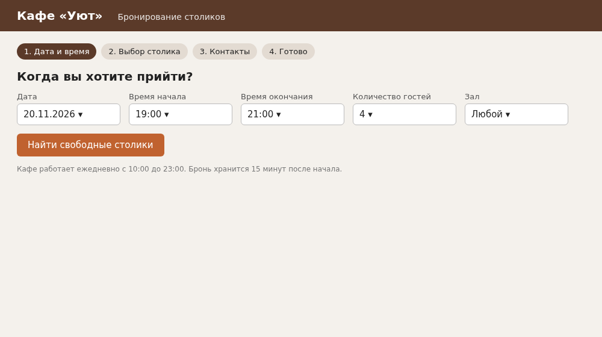
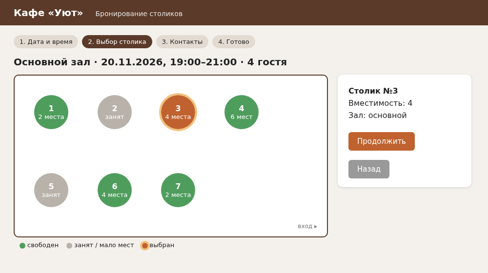
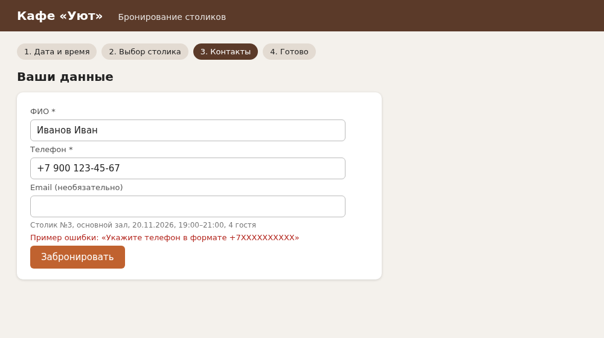
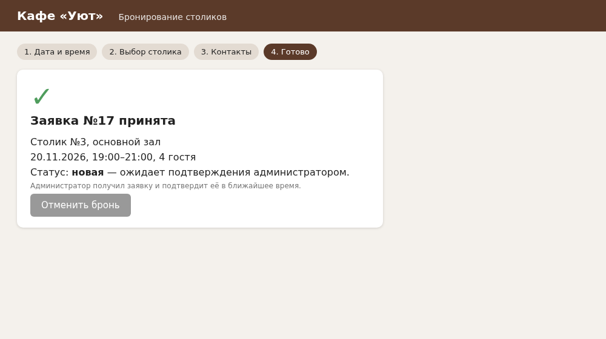
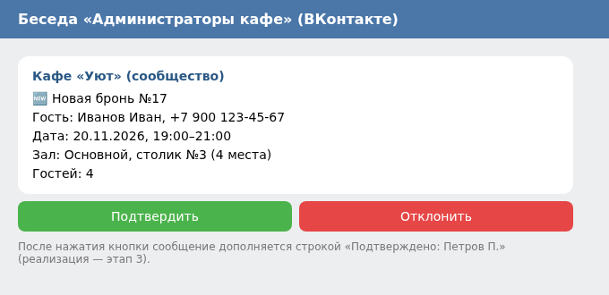
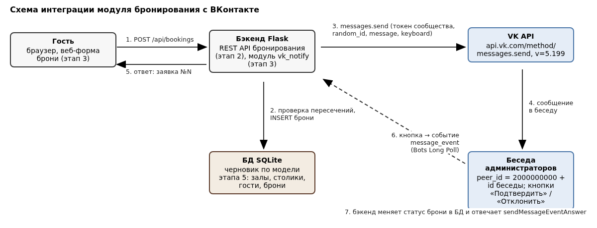

# ПП.11, этап 1. Анализ и прототип

Тема: «Разработка модуля заказа столиков в кафе с пересылкой данных о брони в группу администраторов ВКонтакте». Студент: Войнов Д.А., 3ИП-7-24.

## Введение

Цель этапа 1 — описать сценарий бронирования столика, подготовить макеты страниц модуля и изучить VK API, через который данные о новой брони будут пересылаться в беседу администраторов кафе. По итогам этапа получены сценарий, макеты и схема интеграции с ВКонтакте, на которые опираются этапы 2–4 (бэкенд, фронтенд с отправкой в ВК, тестирование).

Модель данных заново не строится: в качестве черновика используется готовый анализ этапа 5 (ПП.02) — сущности Роли, Пользователи, Гости, Залы, Столики, Брони, ER-диаграмма и нормализация до 3НФ (папка PP.02/week1 репозитория). SQL на этом этапе не пишется.

## Сценарий бронирования столика

### 2.1 Участники

- Гость — посетитель кафе, оформляет бронь через веб-форму на сайте.
- Система — веб-модуль бронирования (бэкенд Flask и база данных).
- Администратор (менеджер) — сотрудник кафе, получает заявку в беседе администраторов ВКонтакте и подтверждает или отклоняет её.

### 2.2 Основной сценарий

1. Гость открывает страницу бронирования и указывает дату, время начала и окончания визита, количество гостей и, при желании, зал.
2. Система показывает схему зала: свободные столики подходящей вместимости, на которых нет других броней, пересекающихся по времени.
3. Гость выбирает столик на схеме и нажимает «Продолжить».
4. Гость вводит ФИО, телефон и (необязательно) email и нажимает «Забронировать».
5. Система проверяет данные, ещё раз проверяет, что столик свободен на этот интервал, сохраняет гостя и бронь со статусом «новая».
6. Система отправляет сообщение с данными брони в беседу администраторов ВКонтакте с кнопками «Подтвердить» и «Отклонить».
7. Гость видит страницу «Заявка №N принята» со статусом «новая».
8. Администратор нажимает кнопку в беседе; система меняет статус брони на «подтверждена» или «отклонена».

### 2.3 Альтернативные сценарии

- Нет свободных столиков на выбранное время — система предлагает изменить время или количество гостей.
- Пока гость заполнял контакты, столик занял другой гость — система сообщает «Столик уже забронирован на это время» и возвращает к выбору столика.
- Неверные данные (пустое ФИО, неверный телефон, время окончания раньше начала, гостей больше вместимости) — система показывает ошибку у поля, бронь не создаётся.
- ВКонтакте недоступен — бронь всё равно сохраняется со статусом «новая», ошибка отправки записывается и отправка повторяется (обработка ошибок — этап 4).
- Администратор отклонил заявку — статус «отклонена», столик снова свободен.
- Гость отменяет бронь — статус «отменена», столик снова свободен.

### 2.4 Статусы брони

Статусы взяты из модели этапа 5: «новая» → «подтверждена» или «отклонена»; бронь «новая» или «подтверждена» можно «отменить». Столик считается занятым только бронями в статусах «новая» и «подтверждена».

**Таблица 2.1 — Связь шагов сценария с моделью данных этапа 5**

| Шаг сценария | Сущности (этап 5) |
|---|---|
| Выбор даты, времени, зала | Залы |
| Показ свободных столиков | Столики, Брони (проверка пересечений) |
| Ввод контактов | Гости |
| Сохранение брони | Брони (оформивший — Пользователи, служебная учётная запись сайта) |
| Подтверждение / отклонение | Брони (статус); в будущем — Пользователи и Роли администраторов |

## Макеты страниц

Макеты выполнены в виде статических HTML-страниц (папка PP.11/stage1/mockups) и показывают четыре шага гостя и вид сообщения в беседе администраторов. Название кафе «Уют» условное.



*Рисунок 1 — Шаг 1: выбор даты, времени и количества гостей*



*Рисунок 2 — Шаг 2: схема зала и выбор свободного столика*



*Рисунок 3 — Шаг 3: ввод контактных данных гостя*



*Рисунок 4 — Шаг 4: заявка принята*



*Рисунок 5 — Сообщение о новой брони в беседе администраторов ВКонтакте*

## Изучение VK API

### 4.1 Подготовка сообщества

1. Создать сообщество кафе ВКонтакте (или использовать существующее).
2. Управление → Сообщения: включить сообщения сообщества.
3. Управление → Сообщения → Настройки для бота: включить «Возможности ботов» и «Разрешать добавлять сообщество в беседы».
4. Создать беседу администраторов и добавить в неё сообщество.
5. Управление → Работа с API → Ключи доступа: создать ключ (токен сообщества) с правом «Сообщения сообщества».
6. Работа с API → Long Poll API: включить Bots Long Poll и событие «Действие с сообщением» (message_event) — понадобится для кнопок на этапе 3.

### 4.2 Токен сообщества

Токен сообщества (ключ доступа) выдаётся в настройках сообщества и позволяет отправлять сообщения от имени сообщества. Токен является секретом: он хранится только в переменной окружения VK_TOKEN на сервере, не записывается в код, репозиторий и отчёты. При утечке ключ удаляется в настройках сообщества и создаётся новый.

### 4.3 Беседа администраторов и peer_id

Сообщения в беседу отправляются по её идентификатору peer_id = 2000000000 + номер беседы (для первой беседы сообщества — 2000000001). Узнать peer_id можно из события message_new, когда в беседе напишут сообщение с упоминанием сообщества, или методом messages.getConversations. Значение хранится в переменной окружения VK_PEER_ID.

### 4.4 Метод messages.send

**Таблица 4.1 — Параметры messages.send, нужные модулю**

| Параметр | Назначение |
|---|---|
| access_token | токен сообщества |
| v | версия API (5.199) |
| peer_id | идентификатор беседы администраторов |
| random_id | уникальное число для каждого сообщения; защищает от повторной отправки одного и того же сообщения |
| message | текст сообщения с данными брони (до 4096 символов) |
| keyboard | JSON инлайн-клавиатуры с кнопками «Подтвердить» и «Отклонить» |

```
POST https://api.vk.com/method/messages.send
access_token = <токен сообщества из переменной окружения VK_TOKEN>
v            = 5.199
peer_id      = 2000000001        (2000000000 + номер беседы)
random_id    = 17000001          (уникален для каждого сообщения)
message      = "Новая бронь №17\nГость: Иванов Иван, +79001234567\n..."
keyboard     = <JSON клавиатуры, см. ниже>

Ответ при успехе:  {"response": 123}            (id сообщения)
Ответ при ошибке:  {"error": {"error_code": 5, "error_msg": "User authorization failed: ..."}}
```

### 4.5 Кнопки «Подтвердить» и «Отклонить»

Для кнопок используется инлайн-клавиатура с кнопками типа callback. В поле payload кладётся действие и номер брони. При нажатии ВКонтакте присылает событие message_event (через Bots Long Poll API), в котором есть payload, peer_id и id нажавшего пользователя. Бэкенд меняет статус брони и отвечает методом messages.sendMessageEventAnswer, чтобы у администратора пропал индикатор загрузки на кнопке. Реализация — этап 3.

```
{"inline": true, "buttons": [[
  {"action": {"type": "callback", "label": "Подтвердить",
              "payload": "{\"action\":\"confirm\",\"booking_id\":17}"},
   "color": "positive"},
  {"action": {"type": "callback", "label": "Отклонить",
              "payload": "{\"action\":\"reject\",\"booking_id\":17}"},
   "color": "negative"}
]]}
```

### 4.6 Ограничения и ошибки

**Таблица 4.2 — Основные ошибки VK API для модуля**

| Код | Значение | Реакция модуля |
|---|---|---|
| 5 | неверный или отозванный токен | записать ошибку, бронь сохраняется, требуется новый токен |
| 6 | слишком много запросов в секунду (для токена сообщества — до 20 в секунду) | повторить позже |
| 9 | flood control — слишком много однотипных действий | повторить позже |
| 10 | внутренняя ошибка сервера ВК | повторить позже |
| 917 | нет доступа к беседе (сообщество не добавлено в беседу) | записать ошибку, проверить настройки беседы |

При повторной отправке используется тот же random_id, поэтому дубликаты сообщения в беседе не появятся. Обработка этих ошибок реализуется на этапе 4.

## Схема интеграции с ВКонтакте



*Рисунок 6 — Схема интеграции модуля бронирования с ВКонтакте*

1. Гость отправляет форму брони, браузер вызывает POST /api/bookings.
2. Бэкенд проверяет данные и пересечения по времени и сохраняет бронь в базу.
3. Бэкенд вызывает messages.send с токеном сообщества.
4. ВКонтакте публикует сообщение с кнопками в беседе администраторов.
5. Гость получает ответ с номером заявки.
6. Администратор нажимает кнопку, ВКонтакте присылает событие message_event.
7. Бэкенд меняет статус брони в базе и подтверждает обработку нажатия.

## Вывод

На этапе 1 описан сценарий бронирования столика с участниками, основным и альтернативными сценариями и статусами брони, связанными с моделью данных этапа 5. Подготовлены макеты четырёх страниц гостя и сообщения в беседе администраторов. Изучен VK API: подготовка сообщества, токен сообщества и его безопасное хранение, peer_id беседы, метод messages.send, callback-кнопки и основные ошибки. Построена схема интеграции, по которой на этапе 2 делается бэкенд, а на этапе 3 — веб-форма и отправка брони в ВК.
