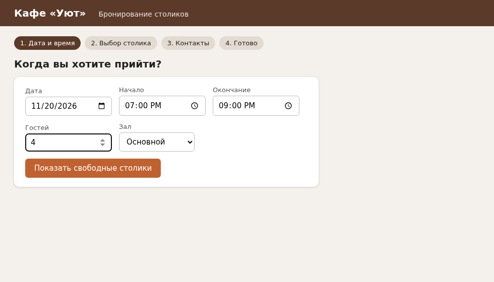
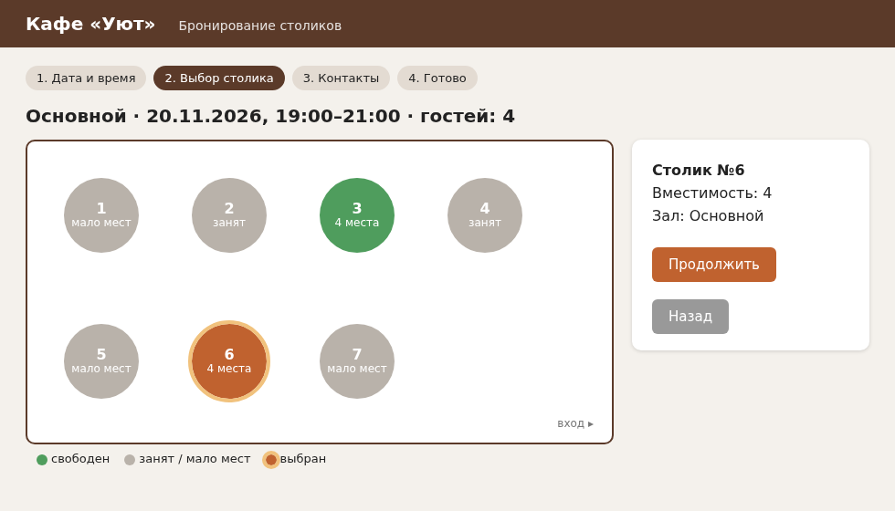
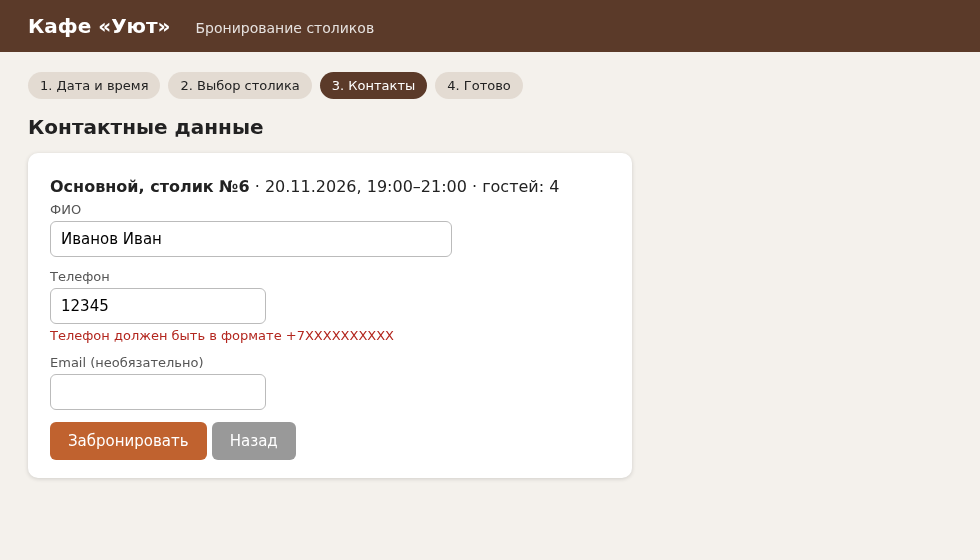
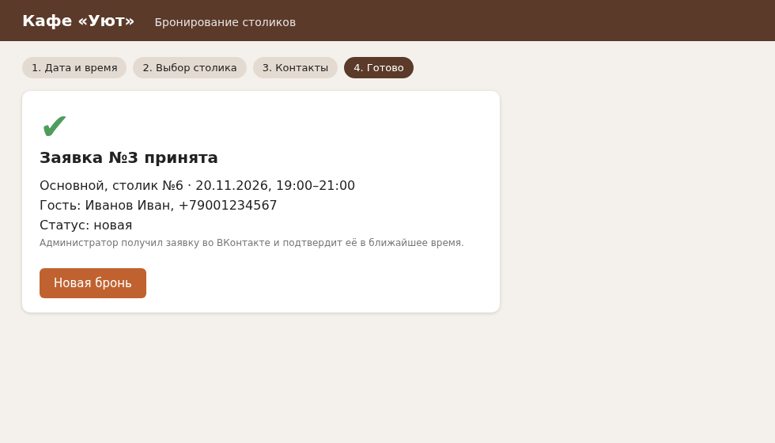
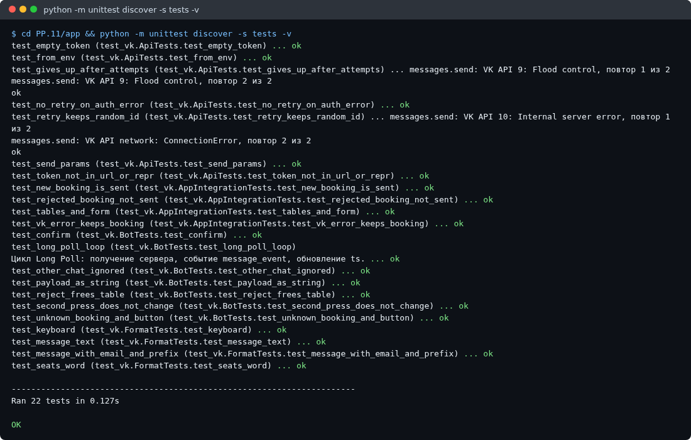
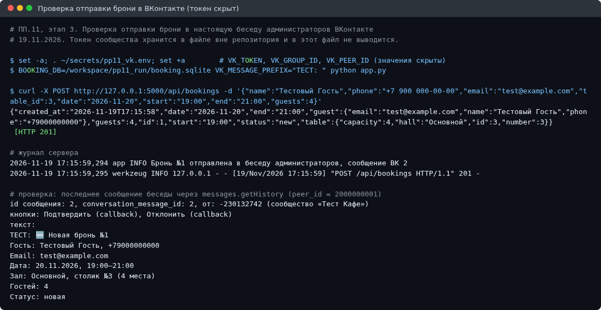
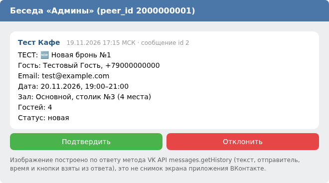

# ПП.11, этап 3. Фронтенд и пересылка в VK

Тема: «Разработка модуля заказа столиков в кафе с пересылкой данных о брони в группу администраторов ВКонтакте». Студент: Войнов Д.А., 3ИП-7-24.

## Введение

Цель этапа 3 — сделать веб-форму брони со схемой зала и пересылку данных о новой брони в беседу администраторов ВКонтакте с кнопками «Подтвердить» и «Отклонить». Работа опирается на сценарий, макеты и схему интеграции этапа 1 и на API бэкенда этапа 2. Подробная обработка ошибок и тестирование всего сценария — этап 4. Код залит в репозиторий в папку PP.11/app, материалы отчёта — в папку PP.11/stage3.

## Структура проекта

**Таблица 2.1 — Файлы, добавленные и изменённые на этапе 3 (PP.11/app)**

| Файл | Назначение |
|---|---|
| static/index.html, static/app.js, static/style.css | веб-форма брони: дата и время, схема зала, контакты, страница «Заявка принята» |
| vk.py | клиент VK API, текст сообщения о брони, клавиатура с кнопками, повтор временных ошибок |
| vk_bot.py | обработка нажатий кнопок через Bots Long Poll: смена статуса брони, правка сообщения |
| app.py | отдача веб-формы, эндпоинт GET /api/tables, отправка новой брони в ВК |
| db.py | функции get_booking (данные брони) и decide_booking (решение администратора) |
| tests/test_vk.py | модульные тесты с заглушкой VK API |
| .env.example | пример настроек ВКонтакте без секретов; сам файл .env исключён через .gitignore |
| requirements.txt | зависимости: Flask, requests |

## Веб-форма брони и схема зала

Форма сделана по макетам этапа 1 и открывается по адресу http://127.0.0.1:5000/. Это одна страница из четырёх шагов, данные берутся из API этапа 2 запросами fetch. На первом шаге гость выбирает дату, время начала и окончания, количество гостей и зал.



*Рисунок 1 — Шаг 1: дата, время, количество гостей и зал*

На втором шаге строится схема зала. Все столики зала приходят из нового эндпоинта GET /api/tables?hall_id=, свободные на выбранный интервал — из GET /api/tables/free (этап 2). Свободные столики подходящей вместимости показаны зелёным и выбираются щелчком, занятые и слишком маленькие — серым с подписью «занят» или «мало мест». Координаты столиков в базе не хранятся, поэтому они расставлены сеткой по номеру, по четыре в ряд.



*Рисунок 2 — Шаг 2: схема зала, выбран столик №6*

На третьем шаге гость вводит ФИО, телефон и email. Форма отправляет POST /api/bookings, ошибки сервера показываются у поля (рисунок 3). Если столик успели занять (ответ 409), форма возвращает гостя к схеме зала с сообщением. Данные гостя вставляются в страницу с экранированием, чтобы исключить XSS.



*Рисунок 3 — Шаг 3: ошибка у поля «Телефон»*



*Рисунок 4 — Шаг 4: заявка принята*

## Пересылка брони в ВКонтакте

После успешного сохранения брони бэкенд вызывает метод messages.send VK API (версия 5.199, хост api.vk.ru) от имени сообщества «Тест Кафе» и отправляет сообщение в беседу администраторов (peer_id = 2000000001). Текст содержит номер брони, гостя, телефон, email, дату и время, зал, столик, количество гостей и статус. К сообщению прикладывается инлайн-клавиатура с callback-кнопками «Подтвердить» и «Отклонить», в payload которых записаны действие и номер брони.

**Таблица 4.1 — Параметры messages.send**

| Параметр | Значение |
|---|---|
| peer_id | VK_PEER_ID из окружения — беседа администраторов |
| random_id | случайное число, выбирается один раз на сообщение и не меняется при повторах |
| message | текст брони (функция format_booking) |
| keyboard | JSON инлайн-клавиатуры (функция booking_keyboard) |
| access_token, v | токен сообщества из VK_TOKEN и версия 5.199 |

Временные ошибки — 6 (много запросов), 9 (flood control), 10 (внутренняя ошибка ВК) и сбой сети — повторяются до трёх раз с паузой 1 и 2 секунды. Остальные ошибки, например 5 (неверный токен), сразу возвращаются как исключение VkError. Ошибка ВК не отменяет бронь: она уже сохранена со статусом «новая», в журнал сервера пишется сообщение об ошибке. Полная обработка недоступности ВК — этап 4.

```
    def call(self, method, **params):
        """Вызов метода. Временные ошибки (6, 9, 10, сбой сети) повторяются с паузой."""
        data = {k: v for k, v in params.items() if v is not None}
        data.update(access_token=self._token, v=API_VERSION)
        for attempt in range(1, self.attempts + 1):
            try:
                resp = self.session.post(self.base + method, data=data, timeout=10)
                body = resp.json()
            except (requests.RequestException, ValueError) as e:
                err = VkError("network", type(e).__name__)
            else:
                if "error" not in body:
                    return body["response"]
                err = VkError(body["error"].get("error_code"), body["error"].get("error_msg", ""))
                if err.code not in RETRY_CODES:
                    raise err
            if attempt == self.attempts:
                raise err
            log.warning("%s: %s, повтор %d из %d", method, err, attempt, self.attempts - 1)
            self.sleep(attempt)               # пауза 1 с, 2 с, ...
```

Токен сообщества берётся только из переменной окружения VK_TOKEN. Он не записывается в код, репозиторий, журнал и отчёт; запросы отправляются методом POST, поэтому токен не попадает в адрес запроса. Если VK_TOKEN или VK_PEER_ID не заданы, форма работает, а пересылка отключается с предупреждением в журнале.

## Кнопки «Подтвердить» и «Отклонить»

Нажатия обрабатывает отдельный процесс vk_bot.py через Bots Long Poll API. Он получает адрес сервера методом groups.getLongPollServer и ждёт событий message_event. Для каждого нажатия бот проверяет, что оно пришло из беседы администраторов, разбирает payload и меняет статус брони: «новая» → «подтверждена» или «отклонена». Затем бот дописывает в сообщение строку «✅ Подтверждено: Имя Фамилия» или «❌ Отклонено: …», убирает кнопки (messages.edit) и показывает нажавшему всплывающее уведомление (messages.sendMessageEventAnswer). Статус меняется только у «новой» брони, поэтому повторное нажатие или нажатие второго администратора ничего не ломает: бот отвечает «Бронь №N уже подтверждена». Отклонённая бронь освобождает столик.

```
        status, verdict = decision
        conn = db.connect(self.db_path)
        try:
            changed = db.decide_booking(conn, booking_id, status)
            booking = db.get_booking(conn, booking_id)
        finally:
            conn.close()
        if booking is None:
            self.answer(event, f"Бронь №{booking_id} не найдена")
            return "бронь не найдена"
        if not changed:
            current = vk.STATUS_RU.get(booking["status"], booking["status"])
            self.answer(event, f"Бронь №{booking_id} уже {current}")
            return f"бронь уже {current}"

        who = self.admin_name(event["user_id"])
        text = vk.format_booking(booking, self.prefix) + f"\n{verdict}: {who}"
        self.api.call("messages.edit", peer_id=event["peer_id"],
                      conversation_message_id=event["conversation_message_id"],
                      message=text, keyboard=vk.EMPTY_KEYBOARD)
        self.answer(event, f"Бронь №{booking_id} {vk.STATUS_RU[status]}")
        return f"бронь №{booking_id} → {status} ({who})"
```

Для метода groups.getLongPollServer ВКонтакте требует у ключа сообщества право «Управление сообществом». У текущего ключа есть только право «Сообщения сообщества», поэтому отправка брони работает, а при запуске vk_bot.py ВК отвечает ошибкой 15 (нет доступа). Обработка кнопок проверена модульными тестами с заглушкой VK API. Чтобы кнопки заработали в настоящей беседе, нужно создать ключ с правами «Сообщения сообщества» и «Управление сообществом».

## Настройки и запуск

```
cd PP.11/app
pip install -r requirements.txt
cp .env.example .env        # вписать VK_TOKEN, VK_GROUP_ID, VK_PEER_ID
set -a; . ./.env; set +a
python app.py               # веб-форма: http://127.0.0.1:5000/
python vk_bot.py            # обработка кнопок (во втором окне)
python -m unittest discover -s tests -v
```

## Модульные тесты

Тесты написаны на unittest. VK API заменён заглушкой, которая отдаёт заранее заданные ответы и запоминает запросы, поэтому тесты не обращаются к настоящему ВКонтакте. Все 22 теста пройдены.

**Таблица 7.1 — Что проверяют тесты**

| Группа | Проверки |
|---|---|
| FormatTests | текст сообщения, email и префикс, склонение «место/места/мест», клавиатура и payload кнопок |
| ApiTests | параметры messages.send; токен не попадает в адрес и repr; повтор ошибок 10 и сети с тем же random_id; ошибка 5 без повтора; отказ после трёх попыток; настройка из окружения |
| AppIntegrationTests | новая бронь отправляется в ВК; бронь с ответом 409 не отправляется; ошибка ВК не отменяет бронь; эндпоинт /api/tables и отдача формы |
| BotTests | подтверждение и правка сообщения; отклонение освобождает столик; повторное нажатие; чужая беседа; неизвестная бронь и кнопка; payload строкой; цикл Long Poll |



*Рисунок 5 — Результат модульных тестов*

## Проверка в беседе ВКонтакте

19.11.2026 в 17:15 МСК сервер запущен с настоящим токеном сообщества «Тест Кафе», через API создана тестовая бронь. Чтобы её нельзя было спутать с настоящей, к тексту добавлен префикс «ТЕСТ:» (переменная VK_MESSAGE_PREFIX). Сообщение пришло в беседу «Админы» (peer_id 2000000001), ВК вернул id сообщения 2. Наличие сообщения, его текст и кнопки проверены методом messages.getHistory. Полный вывод сохранён в PP.11/stage3/vk_demo.txt.

```
# ПП.11, этап 3. Проверка отправки брони в настоящую беседу администраторов ВКонтакте
# 19.11.2026. Токен сообщества хранится в файле вне репозитория и в этот файл не выводится.

$ set -a; . ~/secrets/pp11_vk.env; set +a        # VK_TOKEN, VK_GROUP_ID, VK_PEER_ID (значения скрыты)
$ BOOKING_DB=/workspace/pp11_run/booking.sqlite VK_MESSAGE_PREFIX="ТЕСТ: " python app.py

$ curl -X POST http://127.0.0.1:5000/api/bookings -d '{"name":"Тестовый Гость","phone":"+7 900 000-00-00","email":"test@example.com","table_id":3,"date":"2026-11-20","start":"19:00","end":"21:00","guests":4}'
{"created_at":"2026-11-19T17:15:58","date":"2026-11-20","end":"21:00","guest":{"email":"test@example.com","name":"Тестовый Гость","phone":"+79000000000"},"guests":4,"id":1,"start":"19:00","status":"new","table":{"capacity":4,"hall":"Основной","id":3,"number":3}}
 [HTTP 201]

# журнал сервера
2026-11-19 17:15:59,294 app INFO Бронь №1 отправлена в беседу администраторов, сообщение ВК 2
2026-11-19 17:15:59,295 werkzeug INFO 127.0.0.1 - - [19/Nov/2026 17:15:59] "POST /api/bookings HTTP/1.1" 201 -

# проверка: последнее сообщение беседы через messages.getHistory (peer_id = 2000000001)
id сообщения: 2, conversation_message_id: 2, от: -230132742 (сообщество «Тест Кафе»)
кнопки: Подтвердить (callback), Отклонить (callback)
текст:
ТЕСТ: 🆕 Новая бронь №1
Гость: Тестовый Гость, +79000000000
Email: test@example.com
Дата: 20.11.2026, 19:00–21:00
Зал: Основной, столик №3 (4 места)
Гостей: 4
Статус: новая
```



*Рисунок 6 — Отправка тестовой брони и проверка через messages.getHistory*



*Рисунок 7 — Сообщение о брони в беседе администраторов (построено по ответу messages.getHistory)*

## Вывод

На этапе 3 сделана веб-форма брони из четырёх шагов со схемой зала, которая показывает свободные и занятые столики и работает поверх API этапа 2. При новой брони бэкенд отправляет сообщение с данными в беседу администраторов ВКонтакте с кнопками «Подтвердить» и «Отклонить». Временные ошибки ВК повторяются без дубликатов, токен хранится только в переменной окружения. Отправка проверена в настоящей беседе, обработка кнопок проверена модульными тестами; для её запуска в беседе нужен ключ сообщества с правом «Управление сообществом». Тестирование всего сценария и обработка ошибок (ВК недоступен, неверные данные) — этап 4.
