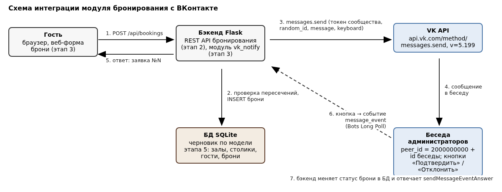
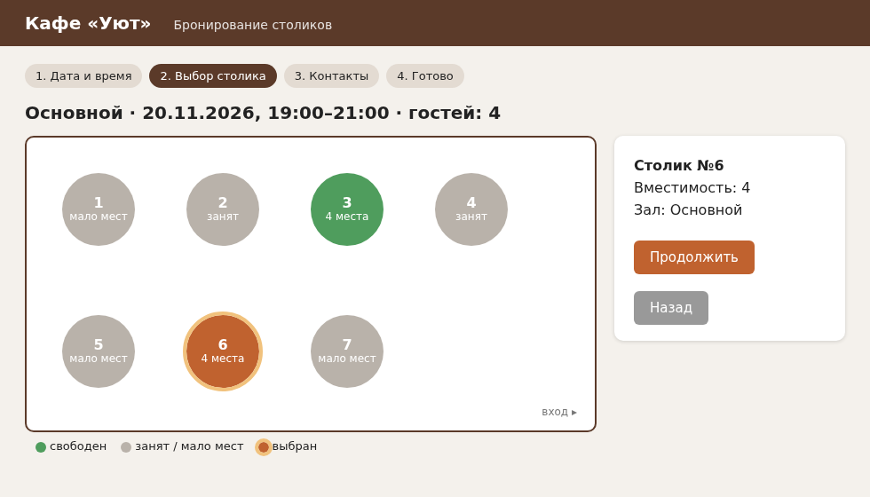
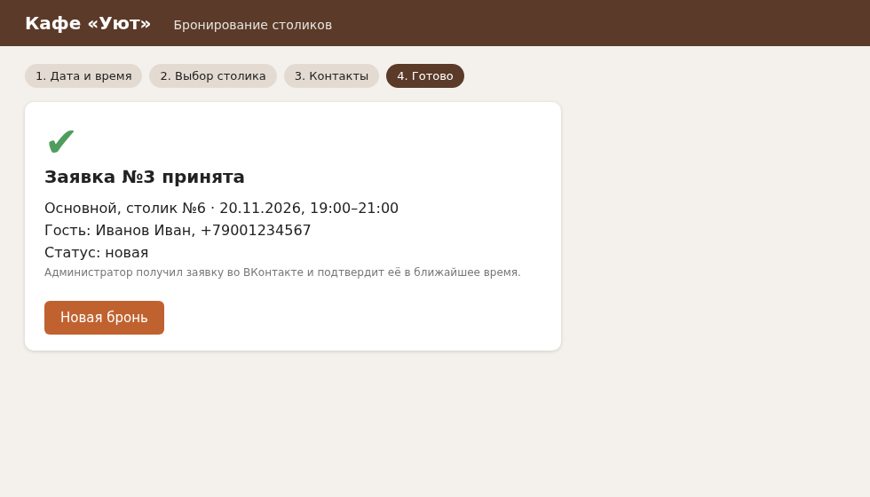
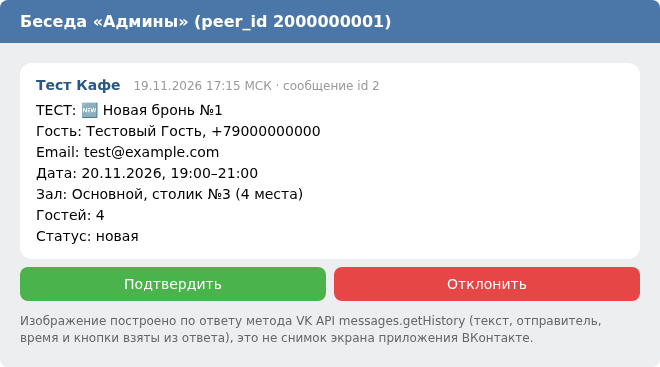
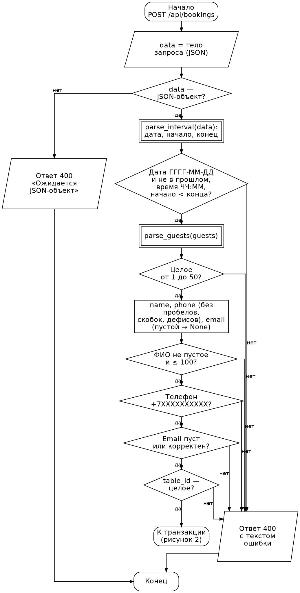
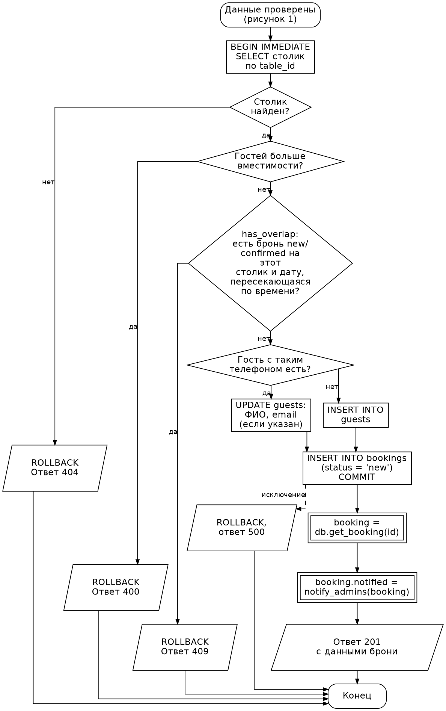
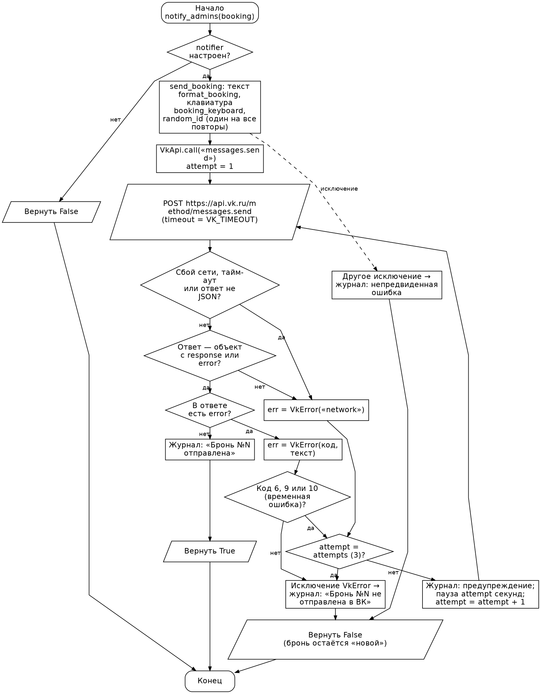
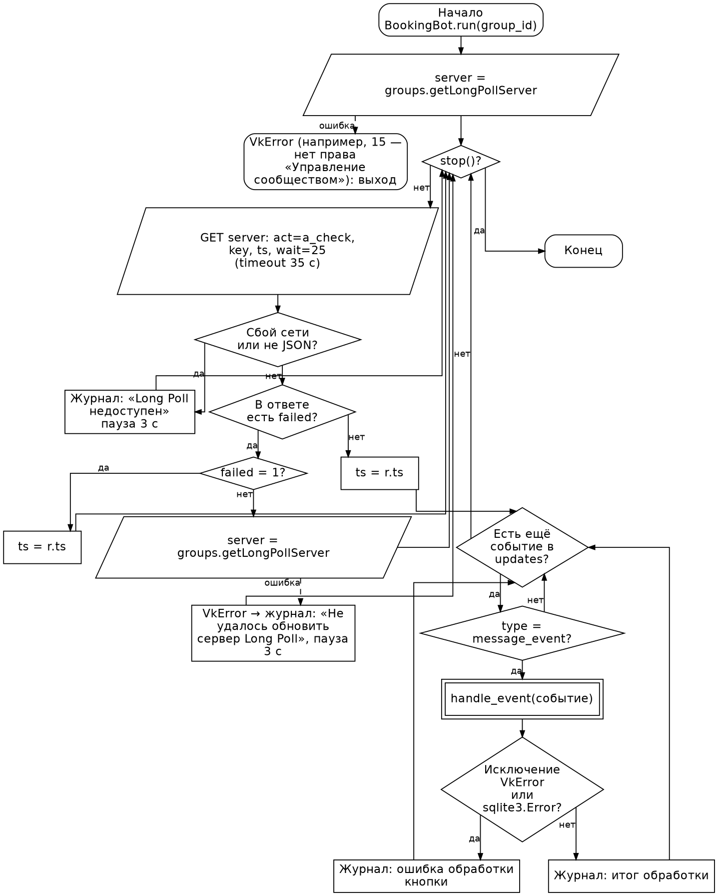
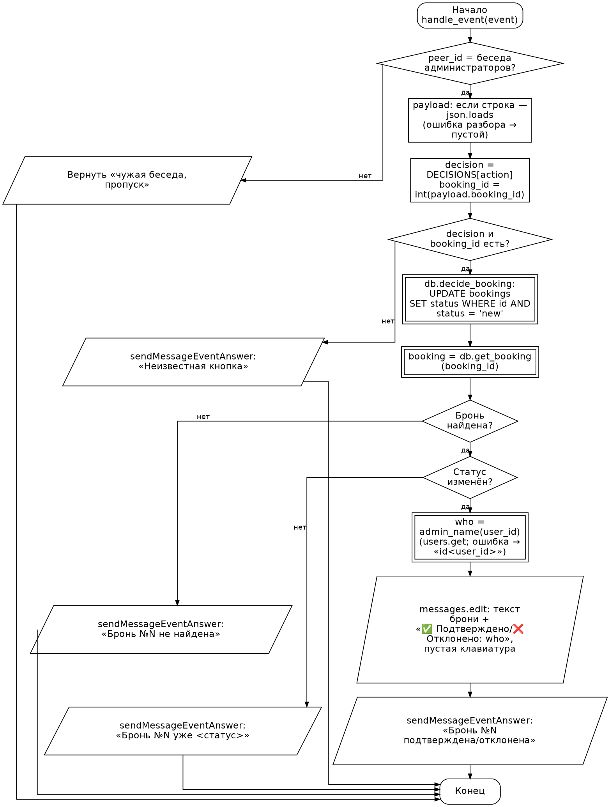
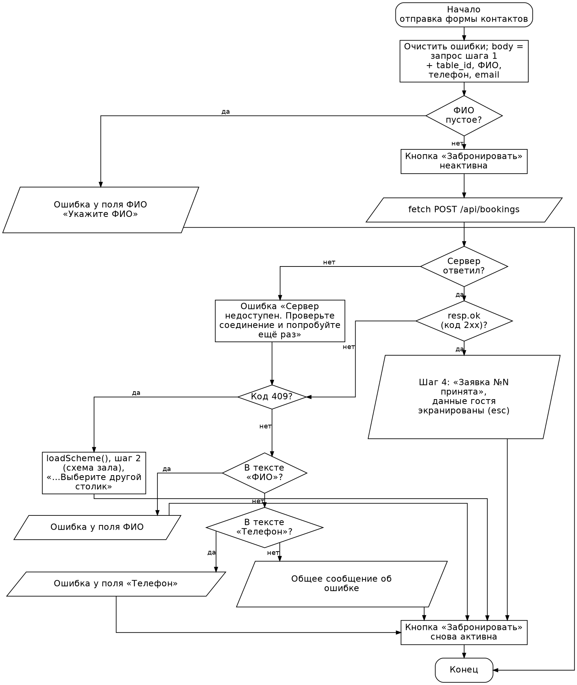

# Итоговый отчёт по ПП.11

Тема: «Разработка модуля заказа столиков в кафе с пересылкой данных о брони в группу администраторов ВКонтакте». Студент: Войнов Д.А., 3ИП-7-24.

## Введение

Тема практики ПП.11 — «Разработка модуля заказа столиков в кафе с пересылкой данных о брони в группу администраторов ВКонтакте». Срок по ведомости: 02.11–05.12.2026. Цель — сделать модуль, через который гость бронирует столик на сайте кафе, а администраторы сразу получают данные о брони в беседе ВКонтакте и подтверждают или отклоняют её кнопками.

Задачи практики: описать сценарий бронирования и сделать макеты страниц, изучить VK API; сделать бэкенд с API бронирования и проверкой пересечений по времени; сделать веб-форму со схемой зала и пересылку брони в беседу администраторов с кнопками «Подтвердить» и «Отклонить»; протестировать весь сценарий и обработать ошибки. Код хранится в репозитории https://github.com/Dre1km0ns/VoinovDmitrii-PP.02-PP.11 в папке PP.11.

## Этапы работы

**Таблица 2.1 — Этапы ПП.11**

| Этап | Содержание | Результат | Папка |
|---|---|---|---|
| 1. Анализ и прототип | сценарий бронирования, макеты страниц, изучение VK API, схема интеграции | сценарий, 5 макетов, схема интеграции | PP.11/stage1 |
| 2. Бэкенд | API на Flask: свободные столики, создание и отмена брони, проверка пересечений; рабочий черновик таблиц по модели этапа 5 | рабочий бэкенд | PP.11/app, PP.11/stage2 |
| 3. Фронтенд и пересылка в VK | веб-форма со схемой зала, отправка брони в беседу администраторов с кнопками | интерфейс, отправка проверена в настоящей беседе | PP.11/app, PP.11/stage3 |
| 4. Тестирование и сдача | тесты всего сценария, обработка ошибок ВК и неверных данных, блок-схемы по коду | 79 тестов пройдены, итоговый отчёт | PP.11/app, PP.11/stage4 |

## Сценарий бронирования

1. Гость открывает страницу бронирования, указывает дату, время начала и окончания, количество гостей и зал.
2. Система показывает схему зала: свободные столики подходящей вместимости, у которых нет броней, пересекающихся по времени.
3. Гость выбирает столик на схеме и вводит ФИО, телефон и, при желании, email.
4. Система проверяет данные, ещё раз проверяет, что столик свободен, и сохраняет бронь со статусом «новая».
5. Система отправляет сообщение с данными брони в беседу администраторов ВКонтакте с кнопками «Подтвердить» и «Отклонить».
6. Гость видит страницу «Заявка №N принята».
7. Администратор нажимает кнопку, статус брони меняется на «подтверждена» или «отклонена», кнопки из сообщения убираются.
8. Гость может отменить бронь, после отмены или отклонения столик снова свободен.



*Рисунок 1 — Схема интеграции с ВКонтакте (этап 1)*

## Устройство модуля

**Таблица 4.1 — Файлы модуля (PP.11/app)**

| Файл | Назначение |
|---|---|
| app.py | приложение Flask: эндпоинты API, проверка входных данных и пересечений, отправка брони в ВК, обработка ошибок |
| db.py, schema_draft.sql | подключение к SQLite, рабочий черновик таблиц по модели этапа 5 (ПП.02), начальный справочник залов и столиков |
| vk.py | клиент VK API с повтором временных ошибок и тайм-аутом, текст сообщения о брони, клавиатура с кнопками |
| vk_bot.py | бот Bots Long Poll: обработка нажатий «Подтвердить»/«Отклонить» |
| static/index.html, app.js, style.css | веб-форма брони из четырёх шагов со схемой зала |
| tests/ | 79 автоматических тестов pytest с заглушкой VK API |
| .env.example | пример настроек ВКонтакте; настоящий токен хранится только в переменных окружения |

**Таблица 4.2 — API модуля**

| Метод и путь | Назначение | Ответы |
|---|---|---|
| GET / | веб-форма брони | 200 |
| GET /api/halls | список залов | 200 |
| GET /api/tables?hall_id= | все столики зала для схемы | 200, 400 |
| GET /api/tables/free?date=&start=&end=&guests=&hall_id= | свободные столики на дату и интервал | 200, 400 |
| POST /api/bookings | создать бронь и переслать её в ВК | 201, 400, 404, 409 |
| GET /api/bookings/<id> | посмотреть бронь | 200, 404 |
| POST /api/bookings/<id>/cancel | отменить бронь | 200, 404, 409 |

Бронь занимает столик, пока она в статусе «новая» или «подтверждена». Два интервала одного столика в одну дату пересекаются, если начало одного раньше конца другого и наоборот; проверка идёт внутри транзакции BEGIN IMMEDIATE, поэтому два одновременных запроса не забронируют один столик дважды. База данных модуля — рабочий черновик SQLite по модели этапа 5; официальный SQL-скрипт и защита БД выполняются в ПП.02.



*Рисунок 2 — Веб-форма: схема зала, выбран столик*



*Рисунок 3 — Веб-форма: заявка принята*



*Рисунок 4 — Сообщение о брони в беседе администраторов (построено по ответу messages.getHistory, этап 3)*

## Блок-схемы алгоритмов

Блок-схемы построены строго по коду модуля (обозначения по ГОСТ 19.701-90: овал — начало и конец, прямоугольник — действие, ромб — условие, параллелограмм — ввод и вывод, прямоугольник с двойными боковыми линиями — вызов подпрограммы). Исходники схем в формате Graphviz и скрипт их построения лежат в PP.11/stage4/flowcharts.

Создание брони (функция create_booking в app.py) разбито на две схемы. Первая — проверка входных данных: при любой ошибке возвращается ответ 400 с текстом ошибки.



*Рисунок 5 — Создание брони: проверка входных данных (app.py, create_booking)*

Вторая — транзакция: поиск столика, проверка вместимости и пересечений, сохранение гостя и брони, отправка в ВК.



*Рисунок 6 — Создание брони: транзакция (app.py, create_booking)*

Отправка брони в беседу администраторов (notify_admins в app.py, send_booking и call в vk.py): временные ошибки повторяются, любая ошибка ВК не отменяет бронь.



*Рисунок 7 — Отправка брони в ВКонтакте (app.py notify_admins, vk.py VkApi.call)*



*Рисунок 8 — Цикл Bots Long Poll бота (vk_bot.py, BookingBot.run)*



*Рисунок 9 — Обработка нажатия кнопки (vk_bot.py, BookingBot.handle_event)*



*Рисунок 10 — Отправка формы контактов (static/app.js)*

## Обработка ошибок и тестирование

Ошибки ВКонтакте (нет сети, тайм-аут, ответ не JSON, ошибки VK API) не мешают гостю: бронь сохраняется до обращения к ВК, временные ошибки повторяются до трёх раз без дубликатов, остальные пишутся в журнал, а в ответе API поле notified показывает, дошло ли сообщение. Бот продолжает работу после сбоев Long Poll. Неверные данные отклоняются сервером с кодом 400 и понятным текстом, ошибки 404, 405 и 500 тоже отдаются в JSON, форма сообщает о недоступном сервере.

Модуль покрыт 79 автоматическими тестами pytest: сквозные тесты всего сценария (бронь → сообщение в беседе → «Подтвердить»/«Отклонить» → отмена), тесты обработки ошибок ВК, включая настоящий отказ соединения и тайм-аут, 24 варианта неверных данных и тесты пересылки этапа 3. Все тесты пройдены. Подробности — в отчёте по этапу 4.

## Безопасность

- токен сообщества хранится только в переменной окружения VK_TOKEN, не попадает в репозиторий, журнал и ответы API, запросы к VK API идут методом POST;
- все запросы к базе параметризованные, поэтому ввод вроде «'); DROP TABLE bookings; --» сохраняется как обычный текст;
- данные гостя вставляются в страницу с экранированием (защита от XSS);
- повторное нажатие кнопки или нажатие второго администратора не меняет уже принятое решение.

## Ограничения

Отправка брони в настоящую беседу администраторов проверена на этапе 3. Для обработки нажатий кнопок в настоящей беседе боту нужен метод groups.getLongPollServer, которому требуется право ключа «Управление сообществом»; у текущего ключа есть только «Сообщения сообщества», поэтому ВК отвечает ошибкой 15. Нажатия проверены тестами с имитацией событий message_event. Чтобы кнопки заработали, достаточно создать ключ с обоими правами и запустить vk_bot.py. Координаты столиков в базе не хранятся, на схеме они расставлены сеткой по номеру.

## Запуск

```
cd PP.11/app
pip install -r requirements.txt
cp .env.example .env        # VK_TOKEN, VK_GROUP_ID, VK_PEER_ID
set -a; . ./.env; set +a
python app.py               # веб-форма: http://127.0.0.1:5000/
python vk_bot.py            # обработка кнопок
python -m pytest -v tests   # 79 тестов
```

## Заключение

В ходе практики ПП.11 разработан модуль заказа столиков в кафе: веб-форма со схемой зала, API бронирования на Flask с проверкой пересечений по времени и вместимости, пересылка данных о брони в беседу администраторов ВКонтакте с кнопками «Подтвердить» и «Отклонить». Модуль обрабатывает недоступность ВКонтакте и неверные данные, весь сценарий покрыт автоматическими тестами (79 тестов, все пройдены), алгоритмы описаны блок-схемами по коду. Для работы кнопок в настоящей беседе требуется ключ сообщества с правом «Управление сообществом».
