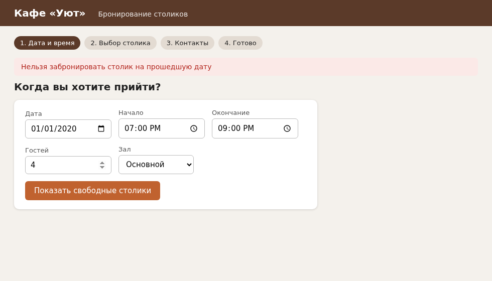
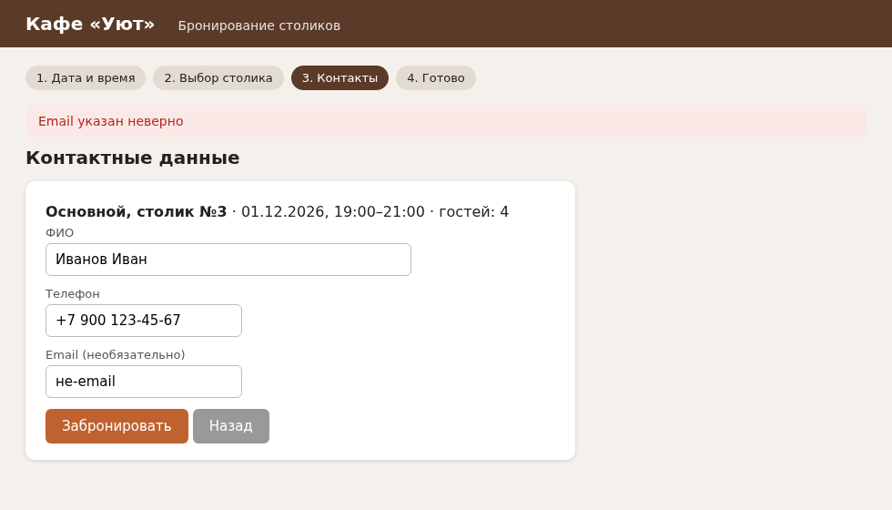
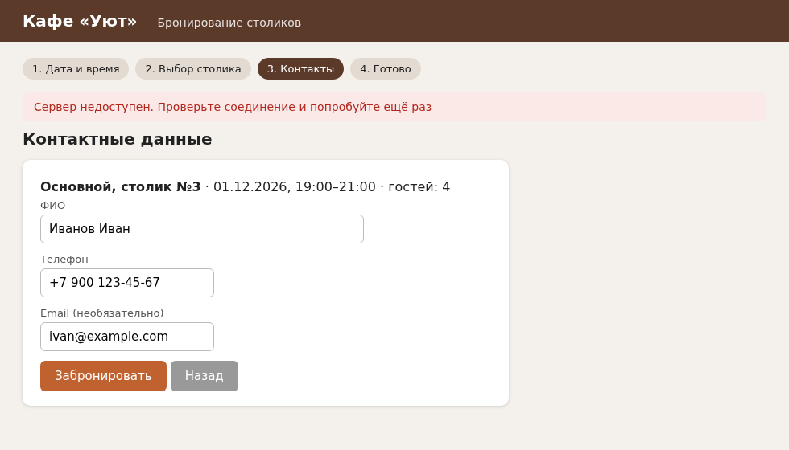
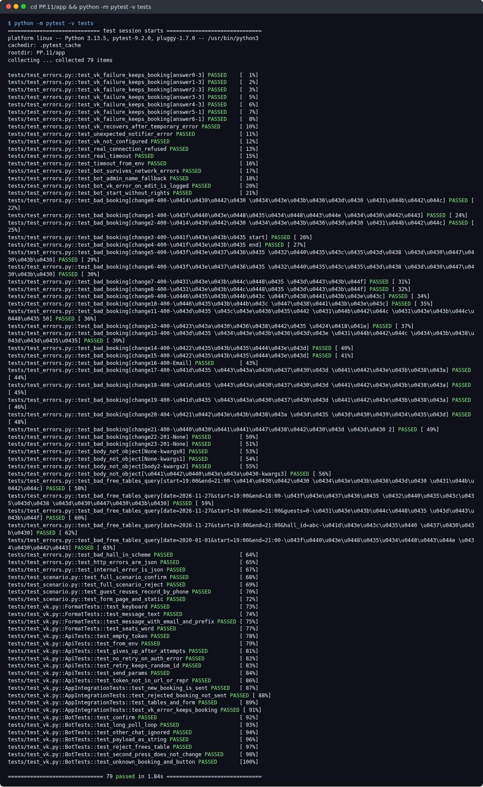
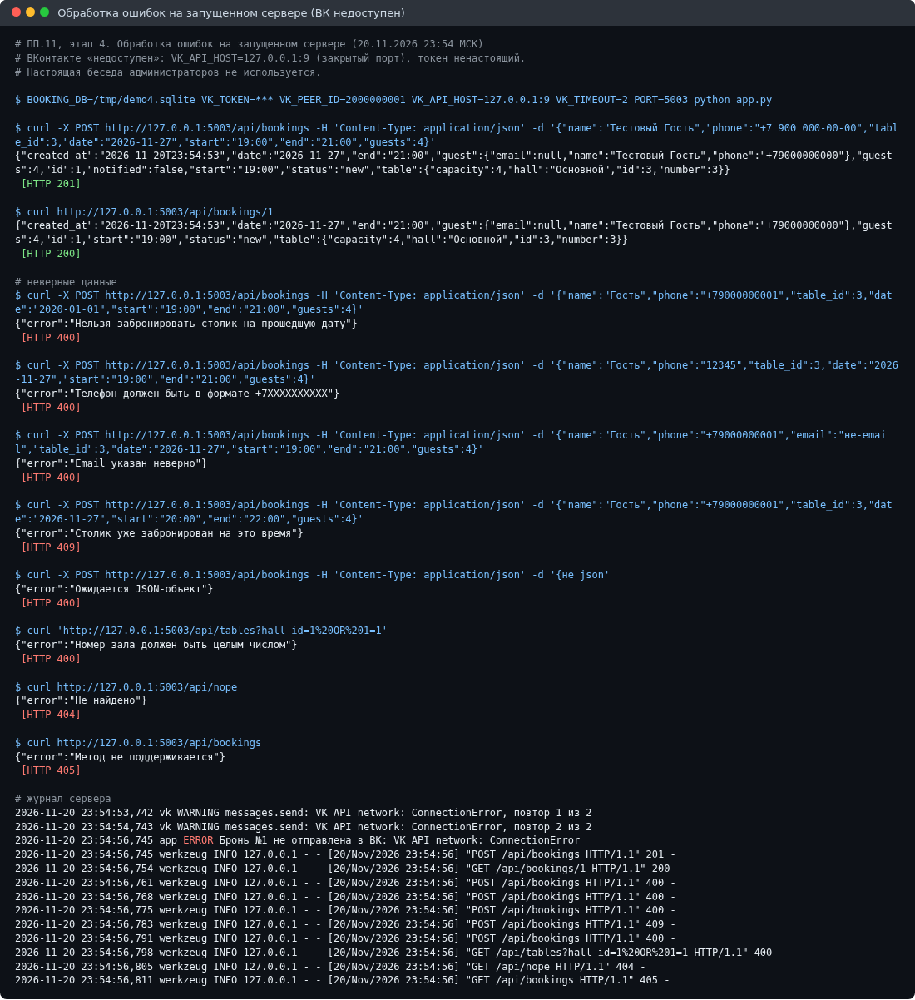

# ПП.11, этап 4. Тестирование и сдача

Тема: «Разработка модуля заказа столиков в кафе с пересылкой данных о брони в группу администраторов ВКонтакте». Студент: Войнов Д.А., 3ИП-7-24.

## Введение

Цель этапа 4 — протестировать весь сценарий бронирования столика и обработать ошибки: недоступность ВКонтакте (нет сети, тайм-аут, ошибки VK API) и неверные данные от гостя. Работа выполняется над модулем этапов 2–3 (PP.11/app): бэкенд на Flask, веб-форма со схемой зала и пересылка брони в беседу администраторов ВКонтакте. Изменения кода залиты в репозиторий в папку PP.11/app, материалы этапа — в папку PP.11/stage4. Итоговый отчёт по ПП.11 с блок-схемами по коду оформлен отдельным документом.

## Изменения кода на этапе 4

**Таблица 2.1 — Изменённые и новые файлы (PP.11/app)**

| Файл | Что сделано |
|---|---|
| app.py | notify_admins перехватывает любую ошибку отправки (VkError и непредвиденные исключения) и возвращает признак notified; новые проверки: дата не в прошлом, ФИО не длиннее 100 символов, формат email, не больше 50 гостей, целые table_id и hall_id; ответы 404, 405 и 500 в формате JSON |
| vk.py | настраиваемый тайм-аут запроса (VK_TIMEOUT, по умолчанию 10 с); ответ без response и error считается сбоем и повторяется |
| vk_bot.py | сбой сети Long Poll, ошибка обновления сервера Long Poll и ошибка базы данных не останавливают бота: запись в журнал и пауза 3 с |
| static/app.js | при недоступном сервере форма показывает «Сервер недоступен. Проверьте соединение и попробуйте ещё раз» |
| tests/conftest.py | общие фикстуры pytest: временная база, заглушка сервера VK API, которая «принимает» сообщения в беседу |
| tests/test_scenario.py | сквозные тесты всего сценария |
| tests/test_errors.py | тесты обработки ошибок ВК и неверных данных |
| tests/test_vk.py | тесты этапа 3; даты броней заменены на «через 7 дней», чтобы тесты не устаревали |
| requirements.txt, .env.example | добавлены pytest и параметр VK_TIMEOUT |

## Обработка ошибок ВКонтакте

Главное правило: ошибка ВКонтакте не должна мешать гостю. Бронь сохраняется в базе до обращения к ВК, поэтому при любой ошибке отправки гость получает обычный ответ 201 «Заявка принята», бронь остаётся в статусе «новая», а в журнал сервера пишется ошибка с номером брони. В ответе API появилось поле notified: true — сообщение дошло до беседы, false — не дошло. Токен сообщества в журнал не попадает: в сообщениях об ошибке есть только код и тип ошибки.

**Таблица 3.1 — Ошибки ВКонтакте и реакция модуля**

| Ситуация | Реакция |
|---|---|
| нет сети, сервер ВК не отвечает (ConnectionError) | до 3 попыток с паузой 1 и 2 с, затем журнал, бронь сохранена, notified = false |
| тайм-аут (сервер принял соединение и молчит) | каждая попытка ограничена VK_TIMEOUT секунд, далее как при сбое сети |
| ответ не JSON (например, страница 502 прокси) или JSON без response и error | считается сбоем сети, повторяется |
| ошибки VK API 6, 9, 10 (много запросов, flood control, внутренняя ошибка) | повторяются, random_id не меняется, поэтому дубликатов в беседе нет |
| остальные ошибки VK API, например 5 (неверный токен), 917 (нет доступа к беседе) | без повтора: журнал, бронь сохранена |
| непредвиденное исключение в модуле ВК | журнал с трассировкой, бронь сохранена |
| ВК не настроен (нет VK_TOKEN или VK_PEER_ID) | предупреждение при запуске, брони принимаются без пересылки |
| бот: сбой Long Poll, устаревший ключ, ошибка ВК или базы при обработке кнопки | журнал и пауза 3 с, цикл продолжается; решение администратора, уже записанное в базу, не теряется |
| бот: ключ без права «Управление сообществом» (ошибка 15) | бот сразу завершается с ошибкой VkError 15, так как без Long Poll работать не может |

```
    def notify_admins(booking):
        """Переслать бронь в беседу администраторов. Возвращает True, если сообщение
        отправлено. Любая ошибка ВК (недоступен, тайм-аут, неверный токен, ответ не JSON
        и т. п.) не отменяет бронь: она уже сохранена со статусом «новая», ошибка
        пишется в журнал, а гость получает обычный ответ 201."""
        if notifier is None:
            return False
        try:
            message_id = notifier.send_booking(booking)
        except vk.VkError as e:
            log.error("Бронь №%s не отправлена в ВК: %s", booking["id"], e)
            return False
        except Exception:                              # непредвиденная ошибка модуля ВК
            log.exception("Бронь №%s не отправлена в ВК: непредвиденная ошибка", booking["id"])
            return False
        log.info("Бронь №%s отправлена в беседу администраторов, сообщение ВК %s",
                 booking["id"], message_id)
        return True
```

## Обработка неверных данных

Все входные данные проверяются на сервере, проверки в форме только помогают гостю. При ошибке API возвращает код 400 и понятный текст, форма показывает его у поля или над формой. Ошибки 404, 405 и 500 теперь тоже возвращаются в JSON, а не HTML-страницей Flask.

**Таблица 4.1 — Проверки входных данных**

| Ситуация | Код | Сообщение |
|---|---|---|
| тело запроса не JSON-объект | 400 | Ожидается JSON-объект |
| неверный формат даты, дата в прошлом | 400 | Дата должна быть в формате ГГГГ-ММ-ДД / Нельзя забронировать столик на прошедшую дату |
| неверный формат времени, окончание не позже начала | 400 | Поле start должно быть в формате ЧЧ:ММ / Время окончания должно быть позже времени начала |
| гостей не целое число, меньше 1 или больше 50 | 400 | Количество гостей должно быть целым числом / больше нуля / не может быть больше 50 |
| пустое ФИО или длиннее 100 символов | 400 | Укажите ФИО / ФИО не должно быть длиннее 100 символов |
| неверный телефон | 400 | Телефон должен быть в формате +7XXXXXXXXXX |
| неверный email | 400 | Email указан неверно |
| столик не указан или не целое число; hall_id не целое | 400 | Не указан столик / Номер зала должен быть целым числом |
| столик не найден | 404 | Столик не найден |
| гостей больше вместимости | 400 | Столик рассчитан на N гостей |
| столик занят на пересекающееся время | 409 | Столик уже забронирован на это время |
| неизвестный адрес, неподдерживаемый метод | 404, 405 | Не найдено / Метод не поддерживается |
| внутренняя ошибка (например, база недоступна) | 500 | Внутренняя ошибка сервера, попробуйте позже |



*Рисунок 1 — Форма: попытка выбрать прошедшую дату*



*Рисунок 2 — Форма: неверный email*



*Рисунок 3 — Форма: сервер остановлен во время отправки*

## Тестирование

Тесты запускаются командой python -m pytest -v tests из папки PP.11/app. Настоящий ВКонтакте в автоматических тестах не вызывается: VK API заменён заглушкой, которая принимает сообщения так же, как беседа, и возвращает заданные ответы и ошибки. Недоступность ВК дополнительно проверена настоящими сетевыми запросами: на закрытый порт (отказ в соединении) и на локальный сервер, который принимает соединение и молчит (тайм-аут).

**Таблица 5.1 — Состав тестов**

| Файл | Тестов | Что проверяется |
|---|---|---|
| test_scenario.py | 4 | весь сценарий: форма, залы, схема, свободные столики, бронь, сообщение в беседе с кнопками, отказ 409 при пересечении, соседний интервал проходит, «Подтвердить» и повторное нажатие второго администратора, отмена гостем и освобождение столика; сценарий с «Отклонить»; повторный гость по телефону |
| test_errors.py | 53 | ВК недоступен: сеть, тайм-аут, не JSON, ошибки 5, 10, 917, восстановление после временной ошибки, непредвиденное исключение, ВК не настроен, настоящий отказ соединения и тайм-аут; бот: сбои Long Poll, отказ users.get, ошибка messages.edit, нет права (ошибка 15); 24 варианта неверных данных брони, тело не JSON, неверные параметры поиска, JSON-ответы 404/405/500 |
| test_vk.py | 22 | тесты этапа 3: текст сообщения, клавиатура, параметры messages.send, повторы, обработка кнопок |

Итог: 79 тестов, все пройдены (79 passed за 1,8 с). Полный вывод сохранён в PP.11/stage4/tests_output.txt.



*Рисунок 4 — Результат запуска тестов pytest*

## Проверка на запущенном сервере

Сервер запущен с ненастоящим токеном и адресом VK API 127.0.0.1:9 (закрытый порт), чтобы смоделировать недоступный ВКонтакте; настоящая беседа администраторов не использовалась. Бронь принята с кодом 201 и notified = false, бронь сохранена со статусом «новая». Модуль сделал 3 попытки отправки и записал ошибку в журнал. Неверные запросы получили ответы 400, 404, 405 и 409. Полный вывод — PP.11/stage4/errors_demo.txt.

```
$ curl -X POST http://127.0.0.1:5003/api/bookings -H 'Content-Type: application/json' -d '{"name":"Тестовый Гость","phone":"+7 900 000-00-00","table_id":3,"date":"2026-11-27","start":"19:00","end":"21:00","guests":4}'
{"created_at":"2026-11-20T23:54:53","date":"2026-11-27","end":"21:00","guest":{"email":null,"name":"Тестовый Гость","phone":"+79000000000"},"guests":4,"id":1,"notified":false,"start":"19:00","status":"new","table":{"capacity":4,"hall":"Основной","id":3,"number":3}}
 [HTTP 201]

$ curl http://127.0.0.1:5003/api/bookings/1
{"created_at":"2026-11-20T23:54:53","date":"2026-11-27","end":"21:00","guest":{"email":null,"name":"Тестовый Гость","phone":"+79000000000"},"guests":4,"id":1,"start":"19:00","status":"new","table":{"capacity":4,"hall":"Основной","id":3,"number":3}}
 [HTTP 200]

# журнал сервера
2026-11-20 23:54:53,742 vk WARNING messages.send: VK API network: ConnectionError, повтор 1 из 2
2026-11-20 23:54:54,743 vk WARNING messages.send: VK API network: ConnectionError, повтор 2 из 2
2026-11-20 23:54:56,745 app ERROR Бронь №1 не отправлена в ВК: VK API network: ConnectionError
```



*Рисунок 5 — Обработка ошибок на запущенном сервере*

## Ограничение: кнопки в настоящей беседе

У текущего ключа сообщества есть только право «Сообщения сообщества». Отправка брони в беседу работает (проверено на этапе 3), но для получения нажатий кнопок через Bots Long Poll нужен метод groups.getLongPollServer, а ему требуется право «Управление сообществом». Без него ВК отвечает ошибкой 15, и бот в настоящей беседе не запускается. Поэтому нажатия «Подтвердить» и «Отклонить» на этапе 4 проверены имитацией: тест берёт сообщение, которое модуль «отправил» в заглушку беседы, достаёт из его кнопок payload и подаёт боту событие message_event в формате Bots Long Poll. Бот проходит тот же код, что и с настоящим ВК. Чтобы кнопки заработали в настоящей беседе, нужно создать ключ сообщества с правами «Сообщения сообщества» и «Управление сообществом» и запустить vk_bot.py.

## Вывод

На этапе 4 весь сценарий бронирования покрыт автоматическими тестами pytest: от выбора столика до решения администратора и отмены брони. Добавлена обработка ошибок: недоступность и тайм-ауты ВКонтакте не мешают гостю и не теряют бронь, бот продолжает работу после сбоев, неверные данные отклоняются с понятным сообщением, а форма сообщает о недоступном сервере. Все 79 тестов пройдены. Нажатия кнопок в настоящей беседе требуют ключа с правом «Управление сообществом», поэтому проверены имитацией события.
